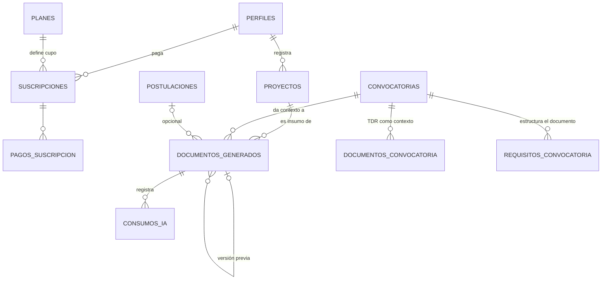

# Modelo de datos (32 tablas)

> Parte de la especificación del MVP **v6** · Plataforma de Gestión de Convocatorias.
> Índice general en `docs/README.md`. Contexto rápido en `CLAUDE.md`.

---

## 9. Modelo de datos

**27 tablas**: 12 base de la v2 (incluida `perfiles`), 10 del módulo de consultores y suscripciones de la v3, 3 del módulo de IA y `eventos_seguridad` de la extensión de seguridad v5, más columnas nuevas en proyectos, planes, suscripciones y perfiles. *Hasta la sesión 003 el documento decía "24 tablas": la cifra no contaba `perfiles` ni `eventos_seguridad`; el conjunto de tablas no cambió.* *(v6, sesión 005: se agrega `invitaciones_admin`, §9.12)* *(v6, sesión 019: se agregan `departamentos` y `convocatoria_departamento`, §9.18; son 29)* *(v6, sesión 032, especificado y sin migración todavía: §9.36 y §9.37 suman 8 tablas, de la 37 a la 44 —países, monedas, países por convocatoria, tasas de referencia, conectores, corridas, cambios en la fuente y externos vetados—)*

### 9.1 Diagrama entidad–relación (módulo de IA y su conexión)



### 9.2 Columnas nuevas en tablas existentes

**PROYECTOS** *(enriquecido — RF-45)*

| Campo | Tipo | Nota |
|---|---|---|
| problema | text | Problema que resuelve |
| objetivo_general | text | |
| objetivos_especificos | text[] | Lista |
| poblacion_beneficiaria | text | |
| actividades | text | Actividades principales |
| resultados_esperados | text | |
| duracion_meses | int | |
| presupuesto_estimado | numeric | |
| experiencia_empresa | text | Trayectoria y capacidad |
| completitud | int | 0–100, calculado sobre los campos de contenido (RF-46). **Lo calcula la base con un trigger al guardar** (§9.17); la aplicación no puede fijarlo |

**PLANES** — se agrega `creditos_ia_mensuales` (int, RF-36). *(mod. v6, sesión 004)* Se agregan también `es_trial` (boolean, default false) y `dias_trial` (int, not null si y solo si `es_trial`): el trial es **un plan más**, con precio 0, rol `empresa`, 3 créditos y 7 días. Hay como máximo un plan trial (índice único parcial) y no aparece en el comparador de planes. Así el cupo del trial se calcula igual que el de cualquier plan, y el administrador puede ajustar sus créditos o su duración sin migración (RF-37, RN-11)

**SUSCRIPCIONES** — se agregan `creditos_usados_periodo` (int), `creditos_extra` (int, paquetes adicionales que no se reinician) y `periodo_creditos_inicio` (date, ancla del reinicio mensual). *(mod. v6, sesión 004)* `plan_id` es **not null también en el trial**: la suscripción trial apunta al plan con `es_trial`, y su `fecha_vencimiento` es `fecha_inicio + dias_trial`

**Registro de cuentas** *(nuevo v6, sesión 004)* — un trigger `after insert` sobre `auth.users` crea en la misma transacción:
- la fila de `perfiles`, con el rol leído de los metadatos del registro. **Solo `consultor` produce consultor; cualquier otro valor —incluido `administrador`— produce `empresa`** (RN-06). La cuenta invitada como administrador también nace así y el servidor la convierte después con `aceptar_invitacion_admin` (§9.12, *rediseñado en la sesión 008*);
- si es empresa: la suscripción trial contra el plan trial (RF-37). Si no existe plan trial activo, el registro **falla** en lugar de crear una empresa sin trial;
- si es consultor: la fila de `consultor_perfiles` en estado `incompleto`, sin suscripción (RN-11, CU-14).
- *(sesión 021, RF-88)* `perfiles.consentimiento_datos_at` (timestamptz, nullable) con `now()` si los metadatos traen `consentimiento_datos = true`. El formulario lo exige; una cuenta creada por otra vía (una invitación de administrador, un registro directo contra Auth) nace sin él. Lo fija solo la base: un trigger impide que el cliente lo cambie; se pone por primera vez con `aceptar_consentimiento_datos()`.

### 9.3 Tablas nuevas

**DOCUMENTOS_GENERADOS**

| Campo | Tipo | Restricción |
|---|---|---|
| id | uuid | PK |
| usuario_id | uuid | FK → perfiles, not null · **RLS** |
| proyecto_id | uuid | FK → proyectos, not null |
| convocatoria_id | uuid | FK → convocatorias, not null |
| postulacion_id | uuid | FK → postulaciones, **nullable** (se vincula si existe) |
| titulo | text | |
| contenido | text | Markdown estructurado por secciones |
| pendientes | text[] | Lista de campos marcados como pendientes (RF-57) |
| estado | text | check: `generando` \| `generado` \| `editado` \| `exportado` \| `error` |
| version | int | default 1 |
| documento_padre_id | uuid | FK → documentos_generados (regeneraciones) |
| plantilla_id | uuid | FK → plantillas_generacion (versión del prompt con que se generó) |
| ajustes_usados | int | default 0 (hasta 3 gratis — RN-17) |
| compartido_con_consultor_id | uuid | FK → perfiles, **nullable** — consultor autorizado a leer/editar; se limpia al revocar o si el encargo deja de estar `en_curso` (RN-22, RN-27, RF-71) |
| ultima_edicion_por | uuid | FK → perfiles, **nullable** — quién hizo el último cambio: la empresa o el consultor autorizado (RNF-11) *(nuevo v5)* |
| creado_at / actualizado_at | timestamptz | |

**PLANTILLAS_GENERACION** — la instrucción del generador como dato versionado (RF-63, CU-37)

| Campo | Tipo | Restricción |
|---|---|---|
| id | uuid | PK |
| nombre | text | not null |
| version | int | not null |
| contenido | text | **Aquí se carga el prompt propio**: instrucciones de estructura, tono, reglas de veracidad y manejo de pendientes |
| activa | boolean | solo una activa a la vez |
| creada_por | uuid | FK → perfiles (admin) |
| creado_at | timestamptz | default now() |

> `documentos_generados` guarda `plantilla_id` para saber con qué versión se produjo cada documento y poder comparar calidad entre iteraciones del prompt.

**CONSUMOS_IA** — bitácora de costo y auditoría (RF-52, RNF-24)

| Campo | Tipo | Restricción |
|---|---|---|
| id | uuid | PK |
| usuario_id | uuid | FK → perfiles |
| documento_id | uuid | FK → documentos_generados, nullable si falló antes de crearse |
| tipo | text | check: `generacion` \| `ajuste` |
| tokens_entrada / tokens_salida | int | |
| costo_estimado | numeric | |
| exito | boolean | **false ⇒ no descontó crédito** (RN-17) |
| mensaje_error | text | |
| fecha | timestamptz | default now() |

> `usuario_id` registra **quién originó** el consumo (puede ser el consultor autorizado que pidió el ajuste). El crédito descontado, sin embargo, siempre sale del cupo de la **empresa dueña del documento** — la capa de aplicación resuelve la suscripción a débitar por `documentos_generados.usuario_id` (el dueño), no por quien disparó la acción (RN-28) *(nuevo v5)*.

### 9.4 Índices adicionales

`documentos_generados (usuario_id)`, `documentos_generados (proyecto_id, convocatoria_id)`, `consumos_ia (usuario_id, fecha)`, `suscripciones (periodo_creditos_inicio)` para el job de reinicio.

### 9.5 Políticas RLS adicionales

| Tabla | Política |
|---|---|
| documentos_generados | La empresa dueña (`usuario_id = auth.uid()`) lee y edita `titulo`, `contenido` y `pendientes`. **El consultor con `compartido_con_consultor_id = auth.uid()` y encargo `en_curso` sobre ese proyecto puede leer y editar `contenido`/`pendientes`, nunca exportar** (RN-22, RN-27, RF-71/72, *ampliado en v5*). **Crear el documento, `ajustes_usados`, `estado`, `version`, `plantilla_id` y la autorización del consultor los escribe solo el servidor** al generar, ajustar, exportar, compartir o revocar: si el cliente pudiera escribir el contador de ajustes, podría ponerlo en 0 y saltarse RN-17 *(precisado en v6, sesión 003)*; admin puede leer para soporte. *(Sesión 026: el consultor ya no tiene política propia; lee y edita por funciones del servidor que registran su lectura, §9.26)* |
| consumos_ia | Solo lectura del propio usuario; escritura desde el servidor; admin lee todo |

### 9.6 Cálculo del porcentaje de compatibilidad (RF-16) *(reescrito en v6, sesión 019 — Sprint 3 paso 2)*

Implementa CU-10, RF-15 y RF-16 en el servidor. El cálculo es un cruce determinístico de atributos, **sin IA** (RN-05).

**`public.sugerencias_proyecto(p_proyecto uuid)`** devuelve una fila por convocatoria **publicada y vigente** (`fecha_cierre >= privado.hoy_colombia()`, RF-15: una vencida queda fuera aunque el job de RF-10 no la haya cerrado) con un booleano por criterio, `coincidencias` y `porcentaje`.

- **`security invoker`**: corre con la sesión de la empresa. La RLS decide qué proyecto es suyo (uno ajeno responde `no_existe`, como si no existiera) y qué convocatorias puede ver (RN-33).
- **Exige suscripción vigente** (CU-10, precondición; RNF-20) con `privado.tiene_suscripcion_vigente(auth.uid())`; sin ella rechaza con `hint = 'sin_suscripcion'` y el endpoint responde 402.
- **Cinco criterios, siempre evaluados los cinco**; `porcentaje = round(coincidencias × 100 / 5)`:

| Criterio | Coincide si |
|---|---|
| Tipo de proyecto, sector, tipo de entidad | el proyecto y la convocatoria comparten **al menos una categoría de ese tipo** |
| Monto | `monto_buscado` no es nulo y cae en `[monto_min, monto_max]`; un extremo nulo no pone límite |
| Ubicación | la convocatoria es de **cobertura nacional**, o su lista de departamentos incluye el **departamento del proyecto** (RN-34, §9.18) |

> *Sesión 032 (especificado):* antes de los cinco criterios se aplica la **elegibilidad por país** (RN-39): solo entran las convocatorias a las que el país de la empresa puede postularse. El monto en otra moneda se compara en pesos con la tasa de referencia (RN-40). Ver §9.36.

- Un criterio sobre el que el proyecto **no tiene dato** (sin categoría de ese tipo, sin monto, sin departamento) **no coincide**. El endpoint lo distingue en el desglose (`sin_dato`) para decirle a la empresa qué completar.
- Devuelve **también las convocatorias con 0 coincidencias**: el endpoint las usa para CU-10 2a y no las muestra. Orden: porcentaje de mayor a menor y, a igual porcentaje, la que cierra antes.
- **CU-10 2a** lo arma el endpoint: si ninguna convocatoria tiene coincidencias, devuelve **los datos que le faltan al proyecto** (en el orden de la tabla) y **hasta 5 vigentes cercanas**, en 0 % y en el orden de la función. *Se descartó "el criterio que menos vigentes cumplen": sin coincidencias, los cinco empatan en cero.*
- **Índices** (RNF-05, < 3 s): `convocatorias (estado, fecha_cierre)`, las claves primarias de `convocatoria_categoria` y `convocatoria_departamento` y la de `proyecto_categoria`. La prueba mide la función con 2 000 convocatorias.

El resultado se acompaña siempre de la aclaración de RN-05: es un cálculo de coincidencias, no una predicción de éxito.

### 9.7 Jobs automáticos (pg_cron)

**"Hoy" es el día en Colombia** *(sesión 017)*: una convocatoria vence al terminar su día de cierre en hora de Bogotá. `privado.hoy_colombia()` —`(now() at time zone 'America/Bogota')::date`— es la única definición, y la usan el cierre, la política de inserción de postulaciones (RF-78), `publicar_convocatoria` (RN-03), `indicadores_catalogo()` (RF-44) y el catálogo del servidor. Antes se usaba `current_date`, que en Supabase va en UTC: desde las 7 p. m. de Colombia, una convocatoria que cerraba ese día ya contaba como vencida. **Desde la sesión 023 (Sprint 4 paso 4, migración `20260930200000`) las suscripciones también usan `privado.hoy_colombia()`**: el trial al registrarse (`crear_cuenta`), los valores por defecto de `suscripciones`, `tiene_suscripcion_vigente()` y el job 2. Solo el job 3 (créditos) sigue con `current_date`: se revisa con los créditos en el Sprint 5.

**RF-78 en la base** *(sesión 017, Sprint 2 paso 7)*: un trigger `before insert or update of convocatoria_id` en `postulaciones` y en `documentos_generados` —`privado.exigir_convocatoria_vigente()`, `security definer`— rechaza con `hint = 'convocatoria_no_vigente'` cualquier fila cuya convocatoria no esté `publicada` y con `fecha_cierre >= privado.hoy_colombia()`. A diferencia de las políticas RLS, **también frena a `service_role`**, que es con lo que escribirán los endpoints de generar (Sprint 4). La política de inserción de postulaciones conserva su propia comprobación (defensa en profundidad). Los endpoints `POST /api/postulaciones` (Sprint 3) y `POST /api/documentos/generar` (Sprint 4) traducen esa clave a **409** con un mensaje claro; **ninguno la sustituye con una comprobación propia que pueda divergir**. Editar o ajustar un documento ya generado no pasa por aquí: la regla es para crear.

El job 1 ejecuta `privado.cerrar_convocatorias_vencidas()`, que devuelve cuántas cerró (lo muestra el historial de `pg_cron`). Corre a las 05:00 UTC, que es medianoche en Colombia.

```sql
-- Job 1 · cierre de convocatorias vencidas (RF-10) — privado.cerrar_convocatorias_vencidas()
UPDATE convocatorias SET estado='cerrada'
WHERE estado='publicada' AND fecha_cierre < privado.hoy_colombia();

-- Job 2 · vencimiento de suscripciones con gracia (RF-39, RN-16, RN-29) — privado.vencer_suscripciones()
-- (sesión 023). Devuelve (en_gracia, vencidas, encargos_cancelados).
UPDATE suscripciones SET estado='en_gracia'
WHERE estado IN ('activa','trial') AND fecha_vencimiento < privado.hoy_colombia();
UPDATE suscripciones SET estado='vencida'
WHERE estado='en_gracia' AND fecha_vencimiento + 5 < privado.hoy_colombia();
-- y, para cada consultor recién vencido:
UPDATE encargos SET estado='cancelado', motivo_cancelacion='Suscripción del consultor vencida'
WHERE consultor_id = <consultor> AND estado IN ('en_curso','pendiente');

-- Job 3 · reinicio mensual de créditos (RF-49, RN-18)
UPDATE suscripciones
SET creditos_usados_periodo = 0,
    periodo_creditos_inicio = periodo_creditos_inicio + INTERVAL '1 month'
WHERE estado IN ('activa','trial')
  AND periodo_creditos_inicio + INTERVAL '1 month' <= CURRENT_DATE;
```

### 9.8 Indicadores públicos de la landing (RF-44)

```sql
SELECT COUNT(*) AS convocatorias_vigentes,
       SUM(COALESCE(monto_max, monto_min)) AS monto_disponible,
       COUNT(DISTINCT entidad_convocante) AS entidades
FROM convocatorias
WHERE estado='publicada' AND fecha_cierre >= CURRENT_DATE;
```

Más el conteo de consultores aprobados. Se sirve con caché de una hora.

*(mod. v6, sesión 006)* Como el catálogo es solo para empresas (RN-33), `anon` no puede leer `convocatorias`. El cálculo vive en la función `public.indicadores_catalogo()` (`security definer`), **la única lectura del catálogo abierta a `anon`**, y devuelve solo las cuatro cifras.

### 9.8b Extensión v5 — enlace oficial de postulación

**Columna nueva en CONVOCATORIAS** (RF-05, RF-09, RF-73, RN-01, RNF-29)

| Campo | Tipo | Restricción |
|---|---|---|
| url_postulacion | text | Validada en el servidor como `http`/`https` bien formada (RNF-29); **obligatoria para publicar** (RN-01) |

No requiere tabla ni política RLS nueva: hereda la misma política de `convocatorias` ya documentada en §9.10 (lectura para cuentas de empresa si está publicada y vigente — RN-33).

### 9.9 Extensión v5 — seguridad y auditoría

Cierra los vacíos detectados en la auditoría de seguridad de la arquitectura: cobertura de RLS incompleta, ausencia de MFA para administradores y falta de visibilidad sobre eventos de abuso (RNF-25..28).

**Nueva tabla EVENTOS_SEGURIDAD** (RNF-11, RNF-25..27, RF-65)

| Campo | Tipo | Restricción |
|---|---|---|
| id | uuid | PK |
| tipo | text | check: `login_fallido` \| `acceso_denegado` \| `limite_tasa` \| `mfa_activado` \| `mfa_fallido` \| `admin_invitado` \| `invitacion_cancelada` \| `admin_revocado` *(los tres últimos, v6 — RF-65)* |
| usuario_id | uuid | FK → perfiles, **nullable** (un login fallido puede no resolver a un usuario existente) |
| ip | inet | |
| ruta | text | endpoint o recurso afectado |
| detalle | text | |
| bloqueado_hasta | timestamptz | **nullable**; solo para `tipo = limite_tasa` — el bloqueo se evalúa comparando contra este valor, sin necesitar un job adicional |
| fecha | timestamptz | default now() |

Índices: `eventos_seguridad (usuario_id, fecha)`, `eventos_seguridad (tipo, fecha)`.

**Columna nueva en PERFILES**

| Campo | Tipo | Nota |
|---|---|---|
| mfa_habilitado | boolean | default false; debe ser `true` antes de que un perfil con rol administrador pueda operar funciones administrativas (RNF-28, CU-38) |

**Política RLS — EVENTOS_SEGURIDAD**

| Tabla | Política |
|---|---|
| eventos_seguridad | Solo lectura para el rol administrador; sin acceso de lectura para empresa o consultor; escritura únicamente desde código de servidor (nunca desde el cliente) |

> El conteo y bloqueo en tiempo real de RNF-27 (límite de tasa) vive en un almacén rápido fuera de Postgres —**Upstash Redis** (elegido por el Product Owner en la sesión 021; Vercel Edge Config se descartó porque sus escrituras tardan hasta 10 s en propagarse y Vercel lo desaconseja para datos que cambian con frecuencia)—, para no sobrecargar la base con una escritura por request; solo el resultado — el bloqueo confirmado — se persiste en `eventos_seguridad` para auditoría y para que el administrador pueda liberarlo (CU-40).

### 9.9b Extensión v5 — contexto y contacto en encargos

Cierra el vacío del marketplace de consultores: la solicitud llevaba solo título y descripción libres, sin el contenido del proyecto ni una convocatoria asociada, y el contacto entre las partes no tenía un punto de revelación definido (RF-68..70).

**Columnas nuevas en ENCARGOS**

| Campo | Tipo | Restricción |
|---|---|---|
| tipo_ayuda | text | check: `convocatoria_especifica` \| `buscar_convocatoria` |
| convocatoria_id | uuid | FK → convocatorias, **nullable** (solo si `tipo_ayuda = convocatoria_especifica`) |
| postulacion_id | uuid | FK → postulaciones, **nullable** — autovinculado si ya existía una postulación en curso para ese par proyecto-convocatoria |
| motivo_cancelacion | text | **nullable** — se completa solo cuando `estado = cancelado`; lo escribe el trigger/job que produce la cancelación (suspensión del consultor o vencimiento de su suscripción, RN-29), nunca el usuario |

No se agrega tabla ni columna para el correo de contacto: se usa el que ya administra Supabase Auth (`auth.users.email`); la capa de aplicación decide **cuándo mostrarlo** (RF-70, RN-26), no dónde guardarlo.

**Política RLS adicional**

| Tabla | Política |
|---|---|
| proyectos, convocatorias (lectura por un consultor) | Un consultor puede leer el proyecto y la convocatoria vinculados a un `encargo` propio **solo mientras ese encargo esté `pendiente`, `en_curso` o `esperando_asignacion`** — no de forma permanente ni sobre otros proyectos de la misma empresa (RN-25) |

### 9.10 Cobertura de RLS — tablas base (v2/v3)

Hasta v4 solo estaba documentada la política de las tablas nuevas del módulo de IA (§9.5); las 21 tablas base no tenían su política explícita por escrito, aunque el diagrama y la arquitectura ya asumían "RLS por usuario". Esta sección traduce las reglas de aislamiento ya establecidas en RNF-03, RN-01, RN-04, RN-07, RN-08, RN-09, RN-12 y RN-22 a política explícita por tabla, cerrando ese vacío (RNF-25).

> Los nombres de tabla aquí usados son los referidos en los casos de uso, los requerimientos y el diagrama entidad–relación de v2/v3. Concílialos con el esquema real al escribir la migración del Sprint 0 si difieren en el detalle.

> **Precondición de todas estas políticas (RN-30, *nuevo v6*):** cada tabla con datos de usuario debe declarar su columna de propietario —`proyectos.usuario_id`, `postulaciones.usuario_id`, `documentos_generados.usuario_id`, `encargos.empresa_id` / `consultor_id`— antes de que la política pueda escribirse. La política RLS y el filtrado por propietario en la capa de aplicación son controles **complementarios**: se exigen los dos, no uno u otro.

| Tabla | Política |
|---|---|
| perfiles | Cada usuario lee y edita solo su propio registro (`id = auth.uid()`); el administrador lee todos |
| proyectos | Solo el dueño (`usuario_id = auth.uid()`) lee, edita y elimina; el administrador lee para soporte (RNF-03) |
| convocatorias, convocatoria_categoria, requisitos_convocatoria, documentos_convocatoria | Lectura **solo para cuentas con rol empresa** de las **publicadas y de las cerradas** —estado `cerrada`, o `publicada` con la fecha de cierre ya vencida— (RN-33, *mod. v6 sesión 006*; **cerradas desde la sesión 017**, para el filtro explícito de RF-11 y RN-02). Borradores y despublicadas siguen invisibles para la empresa. Leer una cerrada no permite actuar sobre ella: crear una postulación exige en su propia política que la convocatoria esté `publicada` y vigente (RF-78), y generar documentos pasa por el servidor. El listado por defecto filtra las vigentes en la consulta, no en la RLS; las tablas hijas heredan la visibilidad de su convocatoria. Escritura exclusiva del administrador (RN-01, RN-07) |
| categorias | Lectura pública de las activas (las usan el registro del consultor y los filtros); escritura exclusiva del administrador |
| proyecto_categoria | Sigue la misma regla que `proyectos`: visible y editable solo por el dueño del proyecto asociado |
| postulaciones y su checklist/historial | Solo la empresa dueña de la postulación (`usuario_id = auth.uid()`); el administrador lee para soporte (RN-04, RNF-03) |
| perfil de consultor (portafolio, especialidades, descripción) | Lectura pública si `estado_perfil = aprobado`; edición solo por el propio consultor. **Sitio web, redes y hoja de vida quedan excluidos de la lectura pública en todos los casos: solo administrador, o la empresa que tenga una solicitud activa —aceptada, encargo `en_curso`, sesión 022— con ese consultor — la condición se evalúa sobre la pareja (empresa de la sesión, consultor), no sobre la existencia de cualquier solicitud** (RN-12, RF-80, RNF-16, *ampliado en v5; precisado en v6*) |
| encargos y sus avances | Visibles solo para la empresa y el consultor del encargo; el administrador lee todos (RN-08, RN-10, RNF-03) |
| calificaciones | Lectura pública (componen el rating); escritura solo por la empresa dueña del encargo calificado, una única vez, inmutable (RN-09, RNF-17) |
| planes | Lectura pública; escritura exclusiva del administrador |
| suscripciones, pagos_suscripcion | Cada suscriptor lee solo las propias; el administrador lee y escribe todas (RNF-20) |

### 9.11 Cómo se aplican las políticas *(nuevo v6, sesión 003)*

Decisiones de mecanismo tomadas al escribir las migraciones (`supabase/migrations/`). No cambian qué puede ver cada rol; fijan cómo se garantiza.

1. **Mínimo privilegio en escritura.** *(Sesión 007: `service_role` necesita `usage` sobre el esquema `privado` y `execute` sobre sus funciones, porque los triggers de las tablas que escribe el servidor las invocan; sin ese permiso sus escrituras sobre `perfiles` fallaban.)* Lo que §9.5 y §9.10 no conceden expresamente al usuario lo escribe solo el servidor (API routes con `service_role`, RNF-26, o jobs de `pg_cron`): encargos y sus avances, calificaciones fuera de la inserción única, consumos de IA, eventos de seguridad, suscripciones y pagos. Esas tablas tienen política de lectura, sin política de escritura para `authenticated`.
2. **Columnas protegidas en filas editables.** Donde el usuario puede editar su propia fila, un trigger rechaza el cambio de las columnas que no le corresponden: en `perfiles`, `rol`, `mfa_habilitado`, `es_propietario`, `admin_revocado_at` y `admin_revocado_por`; en `consultor_perfiles`, `estado_perfil`, `motivo_rechazo`, `es_equipo_interno`, `revisado_por`/`revisado_at`, `rating_promedio` y `total_encargos_completados`; en `proyectos` y `postulaciones`, el propietario; en `documentos_generados`, todo salvo `titulo` (solo dueño), `contenido` y `pendientes`. El `service_role` no queda sujeto a estos triggers.
3. **Administrador = rol + MFA verificado + acceso no revocado.** Toda política que concede algo al administrador exige además `aal2` en el JWT de la sesión (RNF-28, RN-24) y `admin_revocado_at is null` en su perfil (RF-87, *sesión 005*). Un administrador sin segundo factor verificado, o revocado, se trata como un usuario sin privilegios. **Propietario = administrador + `es_propietario`.**
4. **Contacto del consultor por columna.** RLS filtra filas, no columnas. `sitio_web` y `cv_path` quedan sin permiso de lectura directa para `anon` y `authenticated`, y se leen con la función `public.contacto_consultor(consultor_id)`, que los devuelve solo al propio consultor, al administrador o a la empresa con solicitud activa con él (RF-80). `consultor_redes` sigue la misma condición con RLS por fila.
5. **Solicitud activa** (RF-80) = existe un encargo de la pareja (empresa de la sesión, consultor) en estado `en_curso`, es decir, aceptado por el consultor. *(Sesión 022, decisión del Product Owner: hasta entonces también contaba `pendiente`. Lo aplica `privado.solicitud_activa()`, migración `20260927200000`.)*
6. **Acceso derivado del consultor a documentos** (RN-27): la política no se fía de `compartido_con_consultor_id` sola; exige además un encargo `en_curso` de ese consultor sobre el proyecto del documento, evaluado en cada consulta.
7. **Lecturas agregadas por necesidad.** La empresa sigue viendo las convocatorias cerradas o despublicadas que están vinculadas a sus postulaciones, encargos o documentos, porque si no su historial quedaría sin nombre. También ve el perfil de los consultores con los que tuvo encargos, aunque estén suspendidos (RN-15). Estos vínculos se resuelven con funciones `security definer` para evitar recursión entre políticas.
8. **`fuentes` solo para el administrador.** Son configuración interna (notas de parametrización) y el portal público no las muestra; la "lectura pública" de §9.10 aplica a convocatorias, categorías y a las tablas hijas de la convocatoria.
9. **La cuenta la crea la base, no el cliente** *(sesión 004; ampliado en la sesión 005 con las invitaciones de administrador, §9.12)*. `perfiles`, la suscripción trial y `consultor_perfiles` nacen del trigger de registro sobre `auth.users` (ver §9.2), que corre con los privilegios de su dueño. Ninguna de esas tablas gana política de insert para usuarios.


### 9.12 Propietario y administradores por invitación *(nuevo v6, sesión 005)*

Implementa RN-06, RN-31, RN-32 y RF-85..87: el rol administrador deja de asignarse "a mano" y pasa a otorgarlo solo el Propietario, con registro de cada alta y baja.

**Columnas nuevas en PERFILES**

| Campo | Tipo | Restricción |
|---|---|---|
| es_propietario | boolean | not null, default false · **índice único parcial `where es_propietario`**: como máximo uno · check: `not es_propietario or rol = 'administrador'` · solo se escribe desde la consola con `service_role` (RN-31) |
| admin_revocado_at | timestamptz | nullable · no nulo = acceso revocado; `privado.admin_vigente()` lo exige nulo (RF-87) · check: `admin_revocado_at is null or not es_propietario` |
| admin_revocado_por | uuid | FK → perfiles, nullable · quién revocó |

**Nueva tabla INVITACIONES_ADMIN**

| Campo | Tipo | Restricción |
|---|---|---|
| id | uuid | PK |
| correo | text | not null, en minúsculas · índice único parcial `where estado = 'pendiente'` |
| nombre | text | |
| estado | text | check: `pendiente` \| `aceptada` \| `cancelada` \| `vencida` |
| invitado_por | uuid | FK → perfiles, not null (el Propietario) |
| usuario_id | uuid | FK → perfiles **on delete set null** *(sesión 009: cancelar borra la cuenta sin activar)*, nullable · la cuenta creada para la invitación |
| creada_at | timestamptz | default now() |
| expira_at | timestamptz | not null, `creada_at + 72 horas` |
| resuelta_at | timestamptz | nullable · aceptación, cancelación o vencimiento |

**Políticas RLS**

| Tabla | Política |
|---|---|
| invitaciones_admin | Lectura solo para el Propietario con `aal2`; **sin escritura para `authenticated`**: la escriben el servidor (`service_role`) y `aceptar_invitacion_admin` *(sesión 008)* |
| perfiles | Se mantiene §9.10. Ninguna política deja a un administrador cambiar el rol, la revocación ni la marca de Propietario de otro perfil |

**Cómo nace un administrador** *(rediseñado en la sesión 008)*. El diseño anterior reconocía la invitación dentro del trigger de registro, leyendo `app_metadata.invitacion_id`, y no funcionaba: `auth.admin.createUser` e `inviteUserByEmail` insertan el usuario **sin** `app_metadata` y lo añaden después con un `update`, así que el trigger nunca veía la invitación (hallazgo de la sesión 007). Ahora la conversión es un paso explícito del servidor. El trigger de registro vuelve a no saber nada de invitaciones.

1. **Invitar** (endpoint solo del Propietario con `aal2`):
   - con `public.correo_tiene_cuenta(correo)` comprueba que el correo no tenga cuenta (RN-32);
   - inserta la invitación `pendiente`, vigente 72 horas;
   - llama a `auth.admin.inviteUserByEmail(correo, { redirectTo: <origen>/auth/definir-contrasena })`, que crea la cuenta en Auth y envía el correo de invitación. El trigger de registro la crea como empresa con trial, como a cualquier cuenta.
2. **Convertir**, en la misma petición: el servidor llama a `public.aceptar_invitacion_admin(invitacion, usuario)`. La función es `security definer` y **solo la ejecuta `service_role`**. En una transacción exige que:
   - la invitación esté `pendiente` y no vencida;
   - el correo de la cuenta coincida;
   - la cuenta se haya creado **después** de la invitación, lo que garantiza que se creó para ella y no es una cuenta previa;
   - la cuenta no tenga todavía un perfil de administrador.

   Si todo se cumple, pone `rol = 'administrador'`, borra la suscripción trial y el perfil de consultor si los hubiera, y vincula `usuario_id`. Si la función o el envío fallan, el servidor borra la cuenta recién creada y no deja una empresa huérfana.
3. **Activar** (CU-42): la persona abre el enlace, define su contraseña en `/auth/definir-contrasena` y enrola el MFA. `confirmarMfa`, en el servidor y con `aal2` comprobado, marca la invitación `aceptada` y `resuelta_at`.

**Vigencia de los privilegios.** `privado.admin_vigente(usuario)` es la única definición de "administrador con privilegios":
- rol `administrador`;
- `admin_revocado_at` nulo;
- sin invitación vinculada que esté `pendiente` y vencida, `cancelada` o `vencida` *(sesión 009: antes solo excluía la pendiente vencida; así, una invitación cancelada deja la cuenta sin privilegios aunque todavía no se haya borrado)*.

La usan `privado.es_admin()` (RLS, junto con `aal2`) y `public.rol_efectivo()`, que devuelve el rol de la sesión o nulo si es un administrador sin vigencia y que leen `proxy.ts` y `obtenerSesion()`. Así, una invitación que vence sin activarse deja la cuenta sin privilegios en ninguna parte, sin depender de un job.

**Enlace y vigencia son cosas distintas.** El enlace del correo caduca según la configuración de Auth (por defecto, 1 hora); la invitación dura 72 horas. Mientras la invitación esté vigente, el Propietario puede **reenviar** el enlace. Si Auth no admite reenviar una invitación a una cuenta existente, se envía el correo de recuperación de contraseña, que lleva a la misma pantalla.

**Cancelar** una invitación `pendiente` la marca `cancelada` y borra la cuenta vinculada, que nunca llegó a activarse. Una invitación vencida se muestra como tal y se resuelve igual al cancelarla o al invitar de nuevo a ese correo: en ambos casos queda `vencida` y su cuenta se borra. *(Sesión 009.)* Primero se marca la invitación y después se borra la cuenta: si el borrado falla, la cuenta ya no tiene privilegios (`admin_vigente`) y cancelar de nuevo reintenta el borrado.

**Las reglas viven en la base** *(sesión 009)*. Invitar, cancelar y revocar pasan por funciones `security definer` que solo ejecuta `service_role` y que reciben el id del Propietario que actúa. Cada una comprueba que ese id sea el Propietario con privilegios vigentes. El endpoint ya lo comprobó con la sesión; la función lo repite para que ninguna llamada del servidor salte la regla. Lo que no es SQL —enviar el correo, borrar o bloquear la cuenta en Auth— lo hace el endpoint con la API de administración de Auth.

**Funciones nuevas**

| Función | Ejecuta | Qué hace |
|---|---|---|
| `privado.admin_vigente(uuid)` | interna | Regla única de administrador con privilegios (ver arriba) |
| `privado.propietario_vigente(uuid)` | interna | `admin_vigente` y `es_propietario` *(sesión 009)* |
| `public.rol_efectivo()` | `authenticated` | Rol de la sesión; nulo si es administrador sin vigencia |
| `public.soy_propietario()` | `authenticated` | Si la sesión es del Propietario vigente **con `aal2`**. La lee `proxy.ts` para las rutas solo del Propietario (RF-86) *(sesión 009)* |
| `public.correo_tiene_cuenta(text)` | solo `service_role` | Si ya existe una cuenta en Auth con ese correo (RN-32) |
| `public.crear_invitacion_admin(uuid, text, text)` | solo `service_role` | Propietario, correo y nombre. Rechaza correo inválido, correo con cuenta (RN-32) e invitación pendiente para ese correo; inserta la invitación (paso 1) *(sesión 009)* |
| `public.aceptar_invitacion_admin(uuid, uuid)` | solo `service_role` | Convierte la cuenta recién invitada en administrador (paso 2) |
| `public.cancelar_invitacion_admin(uuid, uuid)` | solo `service_role` | Propietario e invitación. Marca `cancelada` (o `vencida` si ya venció) y devuelve la cuenta que el servidor debe borrar. Sobre una ya resuelta con cuenta todavía vinculada, solo la devuelve (reintento) *(sesión 009)* |
| `public.revocar_admin(uuid, uuid)` | solo `service_role` | Propietario y administrador. Rechaza revocarse a sí mismo, revocar al Propietario, a quien no es administrador, a quien ya está revocado y a quien aún tiene la invitación pendiente (eso se cancela). Marca la revocación y **borra sus sesiones de Auth** (`auth.sessions`, con sus *refresh tokens*) *(sesión 009)* |

Los rechazos llevan en `hint` una clave estable (`correo_con_cuenta`, `invitacion_pendiente`, `no_es_propietario`, …) que el endpoint traduce a un mensaje y a un código HTTP.

**Cómo se revoca.** El endpoint de revocación, solo para el Propietario y nunca sobre sí mismo, llama a `revocar_admin`, que escribe `admin_revocado_at`/`admin_revocado_por` y cierra sus sesiones. Con eso la RLS le niega todo en la siguiente consulta y el *refresh token* deja de servir. Después bloquea la cuenta en Auth (`ban_duration`) y registra `admin_revocado`. Si el bloqueo en Auth falla, la revocación ya surtió efecto en la base; el endpoint lo informa.

**Cómo se reenvía.** Mientras la invitación esté `pendiente` y vigente, el endpoint vuelve a llamar a `inviteUserByEmail`, que Auth admite para una cuenta que aún no confirmó su correo. Si la persona ya confirmó (definió la contraseña pero no activó el MFA), Auth lo rechaza y se envía el correo de recuperación hacia `/auth/definir-contrasena`.

**Qué se registra** en `eventos_seguridad`, con `usuario_id` = el Propietario que actuó (RF-65): `admin_invitado` al invitar, `invitacion_cancelada` al cancelar (también cuando se resuelve una vencida al invitar de nuevo) y `admin_revocado` al revocar. El reenvío no tiene tipo propio y no se registra.

**Cómo se designa el Propietario.** *(Ejecutado en la sesión 006.)* Se crea la cuenta con la API de administración de Auth, sin contraseña. Desde la consola se le asigna `rol = 'administrador'` y `es_propietario = true` y se retira el trial que creó el trigger. Después se le envía el correo de recuperación, que lleva a `/auth/definir-contrasena`, y al entrar activa el MFA en `/mfa`. En resumen, una sola vez, desde la consola de la base de datos: `update perfiles set es_propietario = true where id = …`, sobre una cuenta de administrador ya creada. Ninguna migración de la aplicación lo fija a un usuario concreto. El primer administrador —el Propietario— se crea igualmente desde la consola, porque todavía no hay quién invite.

---

### 9.13 Guardar una convocatoria desde el panel *(nuevo v6, sesión 011)*

Implementa RF-05, RF-06 y RF-08 en el servidor. El editor de `/admin/convocatorias/[id]` guarda juntos los datos, las categorías y los requisitos; si se guardaran por separado, un fallo a mitad dejaría una convocatoria con categorías nuevas y requisitos viejos.

**`public.guardar_convocatoria(p_id uuid, p_datos jsonb, p_categorias uuid[], p_requisitos jsonb)`**

- **`security invoker`**: corre con la sesión del administrador, así que la RLS de §9.10 sigue aplicando (administrador vigente con `aal2`). La función además lo comprueba al entrar y rechaza con `hint = 'no_es_admin'`.
- Una sola transacción:
  - actualiza las columnas editables (nombre, entidad convocante, descripción, montos, cobertura —`cobertura_nacional` y el detalle `ubicacion_cobertura`—, fechas, enlace oficial y fuente) y **reemplaza los departamentos** por los de `p_datos -> 'departamentos'` (§9.18) *(sesión 019)*. **No toca `estado`, `creado_por`, `publicado_por` ni `publicada_at`**: publicar y despublicar tienen su propio endpoint (RF-09);
  - reemplaza las categorías (`convocatoria_categoria`) por las recibidas. Solo admite categorías **activas** o que la convocatoria ya tenía (una desactivada después sigue asignada hasta que se quite);
  - sincroniza los requisitos: actualiza los que traen `id` de esa convocatoria, inserta los nuevos y borra los que ya no vienen. El `orden` es la posición en la lista. Borrar un requisito no altera los checklists ya copiados (RN-04; `postulacion_checklist.requisito_id` es `on delete set null`).
- Rechazos con clave estable en `hint`: `no_es_admin`, `no_existe`, `fuente_invalida` (la fuente no existe o está inactiva y no es la que ya tenía), `categoria_invalida`, `requisito_ajeno` (un `id` de requisito de otra convocatoria) y `publicada_incompleta`: una convocatoria `publicada` no puede quedar incompleta según RN-01. La comprobación va **al final**, sobre lo que quedó escrito, con la misma `privado.ficha_publicable` que usa publicar (§9.15), para que las dos reglas no puedan divergir *(restaurada en la sesión 016)*. Para quitarle algo, primero se despublica. Las restricciones de la tabla —montos, fechas, formato del enlace— siguen vigentes.
- **Fecha de cierre ya pasada en una publicada (CU-05 3e, *sesión 017*).** Se permite: la entidad puede cerrar antes de lo anunciado. El endpoint responde 200 con un `aviso` —la convocatoria sigue publicada hasta la medianoche de Colombia, cuando la cierra el job de RF-10— y la pantalla pide confirmación antes de guardar. Publicar, en cambio, sigue rechazando una fecha vencida (RN-03).
- **Montos (CU-02 2b, RF-05).** El endpoint los lee **antes** de llamar a la función: pesos enteros, con puntos cada tres cifras (`1.000.000`) o sin puntos (`1000000`), admitiendo `$` y espacios. Rechaza con 400 los puntos mal agrupados (`1.5`, `1.000000`), la coma decimal, las letras y los negativos. Antes se usaba `Number()`, que convertía `1.000000` en **1 peso** sin avisar (sesión 016). A la columna `numeric` llega siempre un entero.
- **Crear** no pasa por aquí: `POST /api/admin/convocatorias` inserta con la sesión del administrador, `estado = 'borrador'` y `creado_por = auth.uid()` (RNF-11), exigiendo una fuente activa (CU-02, precondición).

**Fuentes y categorías.** Se crean y editan con la sesión del administrador directamente sobre la tabla (§9.10). No hay borrado (RN-07): se desactivan con `activa = false`. Una fuente inactiva no admite convocatorias nuevas; una categoría inactiva deja de ofrecerse para clasificar.

---

### 9.14 Storage: buckets, rutas y adjuntos de convocatoria *(nuevo v6, sesión 012)*

Implementa RF-07 (CU-03) y fija cómo se guarda y se entrega **todo** archivo de la plataforma (RNF-16, RNF-18, RNF-02).

#### Los tres buckets

Los tres son **privados** (`public = false`): ningún archivo se sirve por una URL permanente, sino por URLs firmadas de **máximo 15 minutos** (RNF-16). Hasta v5 solo la hoja de vida figuraba como privada; se corrigió porque un bucket público entrega el archivo a quien adivine la ruta, y los adjuntos de una convocatoria solo pueden verlos las cuentas de empresa (RN-33).

| Bucket | Contenido | Límite | Tipos admitidos | Ruta del objeto |
|---|---|---|---|---|
| `documentos-convocatorias` | TDR, términos, anexos y formatos (RF-07) | 20 MB | PDF, Word (`.doc`, `.docx`), Excel (`.xls`, `.xlsx`), ZIP | `{convocatoria_id}/{documento_id}.{ext}` |
| `fotos-consultores` | Foto del perfil (RF-22) | 5 MB | JPG, PNG | `{perfil_id}/foto-{uuid}.{ext}` *(sesión 021: un nombre nuevo por subida; el anterior se borra al registrar el nuevo)* |
| `hojas-de-vida` | Hoja de vida del consultor (RNF-16) | 10 MB | PDF | `{perfil_id}/hoja-de-vida-{uuid}.pdf` *(ídem)* |

El **tamaño máximo y la lista de tipos se declaran en el bucket**, no solo en el código: una subida que los incumpla la rechaza Storage aunque nadie la haya revisado antes (RNF-18). El nombre del objeto **no es** el nombre del archivo original —así ningún nombre raro llega a la ruta—; el nombre descriptivo que ve el usuario vive en la columna `nombre` y se le devuelve al descargar.

#### Políticas sobre `storage.objects`

Una política por bucket y operación, nunca una regla general (RNF-25):

- **`documentos-convocatorias`**: `select`, `insert`, `update` y `delete` **solo para un administrador vigente con `aal2`** (`privado.es_admin()`). Las empresas **no leen el bucket**: su descarga pasa siempre por el servidor (abajo).
- **`fotos-consultores`** y **`hojas-de-vida`**: escritura y borrado solo del consultor dueño —el primer segmento de la ruta es su `perfil_id`— y lectura solo suya. Igual que arriba, quien más las ve lo hace por URL firmada emitida por el servidor.

#### Cómo se sube un adjunto (RF-07)

Una función de Vercel no admite un cuerpo de 20 MB, así que el archivo **nunca pasa por el servidor**: viaja del navegador a Storage. El control no se pierde, porque la ruta la decide el servidor y la RLS del bucket exige administrador en los dos pasos.

1. `POST /api/admin/convocatorias/[id]/documentos/subida` — el servidor valida el nombre descriptivo, el tipo de documento (`TDR`, `terminos`, `anexo`, `formato`), la extensión y el tamaño declarado; reserva un `documento_id`, arma la ruta y devuelve una **URL firmada de subida** de un solo uso, emitida con la sesión del administrador.
2. El navegador sube el archivo a esa URL.
3. `POST /api/admin/convocatorias/[id]/documentos` — el servidor **comprueba que el objeto existe de verdad** en el bucket y **lee de Storage su tamaño y su tipo reales** (no los que declaró el navegador) antes de insertar la fila.

Si el paso 3 no llega a ocurrir, queda un objeto sin fila: **invisible para todos**, porque no hay descarga que no parta de la fila. La pantalla pide borrarlo si el registro falla.

#### Cómo se descarga

`GET /api/admin/convocatorias/[id]/documentos/[docId]/enlace` devuelve una URL firmada de 15 minutos, con el nombre descriptivo como nombre de descarga. **La autorización la decide la RLS**: el servidor lee primero la fila de `documentos_convocatoria` con la sesión de quien pide —si no puede verla, no existe para él— y solo entonces firma. El mismo endpoint sirve a la empresa cuando llegue el catálogo (Sprint 2, paso 4), sin cambiar la regla: la fila es visible o no lo es.

#### La empresa descarga los adjuntos *(sesión 016, Sprint 2 paso 4)*

Hasta aquí solo el administrador podía leer objetos del bucket `documentos-convocatorias`, y firmar una URL de descarga exige poder leer el objeto con la sesión de quien la pide. Se añade una política de `select` sobre `storage.objects` para `authenticated`: **un objeto se puede leer si su fila de `documentos_convocatoria` es visible para quien pide** (`exists (select 1 from documentos_convocatoria d where d.storage_path = name)`). Así Storage hereda la visibilidad de la tabla, que a su vez hereda la de `convocatorias`: la empresa descarga los adjuntos de las publicadas y vigentes (RN-33), y nadie más gana acceso. No se abre el bucket ni se firma con `service_role`.

#### Columnas nuevas en `documentos_convocatoria`

| Columna | Tipo | Para qué |
|---|---|---|
| `tipo_mime` | `text not null default ''` | El tipo real leído de Storage, no el declarado |
| `tamano_bytes` | `bigint` | Se muestra junto al nombre; también permite detectar una subida truncada |
| `actualizado_at` | `timestamptz not null default now()` | Cambia al renombrar |

`storage_path` pasa a ser **único**: dos filas no pueden apuntar al mismo objeto.

#### Modificar y quitar (CU-03 1a)

- **Renombrar** (`PATCH`): nueva política de `update` para el administrador. Un **trigger** impide que ese update cambie `convocatoria_id`, `storage_path` o `tamano_bytes`: renombrar es cambiar el rótulo, no el archivo. Para reemplazar el archivo se quita el adjunto y se sube otro.
- **Quitar** (`DELETE`): borra la fila y el objeto. Aquí sí hay borrado, a diferencia de fuentes y categorías (RN-07): un adjunto equivocado no es historia que valga la pena conservar, y CU-03 1a lo pide.
- Renombrar no depende del estado de la convocatoria. **Quitar sí, en un caso** *(sesión 016)*: a una convocatoria `publicada` no se le puede quitar **su último adjunto**, porque RN-01 exige al menos uno para estar publicada (CU-03 1b). Un trigger `before delete` en `documentos_convocatoria` lo hace cumplir en la base, también para `service_role`. Bloquea antes la fila de la convocatoria (`for update`, como `guardar_convocatoria`), para que dos borrados simultáneos no la dejen en cero. Rechaza con `hint = 'publicada_incompleta'`, que el endpoint traduce a **409**. Para reemplazar el único adjunto de una publicada se sube el nuevo y después se quita el viejo. El borrado en cascada de la convocatoria entera no se ve afectado: la fila padre ya no existe cuando se evalúa.

---

### 9.15 Publicar y despublicar una convocatoria *(nuevo v6, sesión 013)*

Implementa RF-09 y RN-01 en el servidor. Cambiar el estado es lo único que `guardar_convocatoria` (§9.13) deja fuera a propósito: la ficha se edita todo lo que haga falta sin que la convocatoria se vuelva visible por accidente.

**`public.publicar_convocatoria(p_id uuid, p_publicar boolean)`**

- **`security invoker`**, igual que §9.13: corre con la sesión del administrador y la RLS sigue aplicando; la función lo comprueba además al entrar.
- **Publicar** (`p_publicar = true`) exige, en una sola lectura con bloqueo de la fila, **la ficha completa de RN-01** *(lista ampliada en la sesión 015)*:
  - nombre y entidad convocante (la tabla ya los pide);
  - **cobertura: nacional o al menos un departamento** (RN-34, §9.18; *hasta la sesión 018 se exigía el texto `ubicacion_cobertura`, que pasa a ser un detalle opcional*) y **descripción u objeto**;
  - **enlace oficial de postulación** presente y bien formado (RNF-29). La restricción `convocatorias_publicada_con_enlace` lo repite;
  - **al menos una categoría** en `convocatoria_categoria`;
  - **al menos un documento adjunto** en `documentos_convocatoria`;
  - **al menos dos requisitos** en `requisitos_convocatoria`;
  - **fecha de cierre no vencida**: no se publica algo que ya cerró, porque el job de RF-10 lo cerraría esa misma noche y porque RN-03 prohíbe postular sobre ello.

  Cobertura y categorías son además los filtros del catálogo (RF-12): sin ellas la convocatoria no aparecería al filtrar. El adjunto **volvió a ser obligatorio** en la sesión 015, después de haber dejado de serlo en la 012.

  Al publicar: `estado = 'publicada'`, `publicada_at = now()` y `publicado_por = auth.uid()` (RNF-11). Se puede publicar desde **cualquier** estado que no sea `publicada`, incluido `cerrada` — si alguien corrige la fecha de cierre de una cerrada, debe poder volver a publicarla sin quedarse sin salida.
- **Despublicar** (`p_publicar = false`) exige que esté `publicada` y la deja en `despublicada`, conservando `publicada_at` y `publicado_por` como rastro de que estuvo publicada. No se borra nada (RN-07). A partir de ahí no se puede postular ni generar sobre ella (RN-03), y las postulaciones ya iniciadas conservan su checklist (RN-04).
- Rechazos con clave estable en `hint`: `no_es_admin`, `no_existe`, `ya_publicada`, `no_publicada`, `publicada_incompleta` y `vencida`.

**Editar una publicada tiene la misma vara** *(sesión 016)*: `guardar_convocatoria` (§9.13) rechaza con `publicada_incompleta` cualquier edición que deje a una publicada sin algo de la lista anterior (salvo la fecha de cierre vencida, que es asunto del job de RF-10). En la sesión 015 esta comprobación se retiró porque se creyó que causaba un cuelgue de ~20 s al guardar. La sesión 016 demostró que el cuelgue venía de la red de la máquina de desarrollo (`docs/incidentes/2026-09-22-cuelgue-al-guardar-convocatoria.md`) y se restauró. El adjunto no se quita por `guardar_convocatoria` sino por `DELETE` sobre `documentos_convocatoria`; ese camino tiene su propio trigger desde la sesión 016 (§9.14, *Modificar y quitar*).

**Publicar guarda primero.** La pantalla envía el formulario a `PATCH` y solo llama a `publicar` si ese guardado pasa (RF-09, CU-05 3d). Sin eso, publicar tomaba lo último guardado e ignoraba lo que el administrador tenía delante: se podía ver un campo vacío en pantalla y publicar con el valor viejo. Lo detectó el Product Owner en la sesión 015.

**Por qué la lista de lo que falta la arma el servidor y no el SQL.** La función rechaza con una sola clave; el endpoint lee antes la ficha y responde 400 enumerando **todo** lo que falta de una vez, para que el administrador no descubra los problemas de uno en uno. La función es la barrera; el enunciado es cortesía.

---

### 9.16 Nombres repetidos y borrado de categorías *(nuevo v6, sesión 014)*

Implementa RF-04, RF-06 y la precisión de RN-07. Nace de dos cosas que el Product Owner encontró probando el panel: pudo crear `Transformación digital` y `Transformacion digital` como dos categorías distintas, y no tuvo forma de quitar la sobrante.

#### Comparación de nombres

`unique (tipo, nombre)` comparaba letra por letra, así que una tilde de diferencia bastaba para colar un duplicado. En español no son nombres distintos. Se compara ahora por el **nombre normalizado**:

**`privado.nombre_normalizado(text)`** — `immutable`, para que sirva de índice: recorta espacios de los extremos, quita los acentos con `unaccent` y pasa a minúsculas. Se fija el diccionario explícitamente (`'extensions.unaccent'::regdictionary`) porque de otro modo `unaccent` depende del `search_path` y no podría declararse inmutable.

- `categorias`: índice único sobre `(tipo, privado.nombre_normalizado(nombre))`. Se conserva además el `unique (tipo, nombre)` original, que es un caso particular.
- `fuentes`: índice único sobre `privado.nombre_normalizado(nombre)`. **Antes no tenía ninguno**: se podían crear dos fuentes idénticas.

**El nombre se guarda tal como se escribió.** La normalización solo decide si dos nombres chocan; lo que se muestra es lo que tecleó el administrador, con sus tildes.

**Duplicados que ya existan** al aplicar la migración se fusionan, no se pierden: las convocatorias que apuntaban a la copia se reasignan a la fila **más antigua** y la copia se borra. En `convocatoria_categoria` la reasignación es `on conflict do nothing`, por si una convocatoria tenía las dos. Si dos fuentes duplicadas traían notas distintas, gana la más antigua.

#### Borrar una categoría (RN-07)

Fuentes y convocatorias siguen sin borrarse: guardan historia. Una categoría **que ninguna convocatoria usa** no guarda nada, así que se borra. La regla vive en la política RLS, no en la pantalla:

```
categorias: el administrador borra las no usadas
  delete · es_admin() ∧ no existe convocatoria_categoria con esta categoría
```

Si ya clasifica algo, la política no encuentra la fila y el borrado devuelve **0 filas** — no un error. Por eso el endpoint cuenta el uso **antes** y responde 409 diciendo cuántas convocatorias la usan, en vez de un 404 que haría pensar que no existe. El listado del panel trae ese conteo, de modo que el botón de borrar solo aparece donde borrar es posible; el servidor lo vuelve a comprobar igual (RNF-20).

`DELETE /api/admin/categorias/[id]`.

---

### 9.17 Proyectos de la empresa *(nuevo v6, sesión 018 — Sprint 3 paso 1)*

Implementa RF-14, RF-45, RF-46 y RF-81 en el servidor (CU-09). La RLS de §9.10 ya limitaba `proyectos` y `proyecto_categoria` a su dueño (RN-30); aquí se añade cómo se guardan.

**`public.guardar_proyecto(p_id uuid, p_datos jsonb, p_categorias uuid[]) returns uuid`**

- **`security invoker`**: corre con la sesión de la empresa, así que la RLS decide. Con `p_id` nulo crea el proyecto (`usuario_id` lo fija la base con `auth.uid()`); con un id, lo edita si es suyo, y si no lo es responde `no_existe`, como si no existiera.
- Una sola transacción para los datos y las categorías: se reemplazan por las recibidas. Solo admite categorías **activas** o que el proyecto ya tenía (`categoria_invalida`).
- Rechazos con clave estable en `hint`: `no_existe` y `categoria_invalida`. La forma de los datos —longitudes, montos en formato colombiano (CU-02 2b), duración entera— la valida antes el endpoint.

**`completitud` la calcula un trigger** (`before insert or update`) con la misma regla que `lib/proyectos.ts`: nueve campos de contenido; un texto cuenta si no está en blanco, `objetivos_especificos` si tiene alguno no vacío, duración y presupuesto si son mayores que cero; `round(completos × 100 / 9)`. Lo que envíe la aplicación en esa columna se ignora. `lib/proyectos.ts` sigue siendo quien enumera los campos que faltan en pantalla (RF-46, RF-81), y una prueba comprueba que las dos cuentas coinciden.

**Borrar un proyecto** (CU-09 2a): `proyecto_categoria` y **`documentos_generados` se borran en cascada**, las postulaciones quedan sin proyecto (`on delete set null`) y **un proyecto con encargos no se puede borrar** (la clave foránea lo impide). El endpoint responde 409 con ese motivo y la pantalla, antes de confirmar, dice cuántos documentos generados se perderán.

---

### 9.18 Departamentos y cobertura *(nuevo v6, sesión 019 — RN-34)*

Hasta la sesión 018 la ubicación era texto libre en los dos lados (`Colombia (nacional)` frente a `Barranquilla`), y ni el filtro del catálogo ni la compatibilidad podían compararla de forma confiable. Por decisión del Product Owner pasa a la lista oficial de departamentos.

**DEPARTAMENTOS** — catálogo fijo, sembrado por la migración (los 32 departamentos y Bogotá D.C.):

| Campo | Tipo | Restricción |
|---|---|---|
| codigo | text | PK, código DANE de dos cifras (`'05'` Antioquia … `'99'` Vichada) |
| nombre | text | not null, unique |

RLS: lectura para `authenticated`; **ninguna política de escritura**: la lista solo cambia por migración. `lib/departamentos.ts` tiene la misma lista para las pantallas, y una prueba comprueba que coinciden.

**CONVOCATORIA_DEPARTAMENTO** — `convocatoria_id` (FK, `on delete cascade`) + `departamento_codigo` (FK), PK compuesta, índice por `departamento_codigo`. Las mismas políticas que `convocatoria_categoria`: se ve con su convocatoria; escribe solo el administrador.

**Columnas nuevas**

| Tabla | Campo | Tipo | Nota |
|---|---|---|---|
| convocatorias | cobertura_nacional | boolean not null default false | Si es verdadero, la convocatoria no lleva departamentos |
| proyectos | departamento_codigo | text null, FK a `departamentos` | Donde se ejecuta el proyecto. Nulo mientras la empresa no lo indique |

`convocatorias.ubicacion_cobertura` y `proyectos.ubicacion` **se conservan como detalle en texto** (municipios, zona): se muestran y alimentan el documento con IA, pero **nunca se comparan**.

**Escritura**

- `guardar_convocatoria` (§9.13) lee `p_datos ->> 'cobertura_nacional'` y `p_datos -> 'departamentos'` (arreglo de códigos). Con cobertura nacional **borra los departamentos**; un código inexistente rechaza con `hint = 'departamento_invalido'`. El endpoint rechaza antes con 400 si llegan las dos cosas o un código que no está en la lista.
- `guardar_proyecto` (§9.17) lee `p_datos ->> 'departamento_codigo'`; un código inexistente rechaza con `departamento_invalido`.
- `privado.ficha_publicable` exige `cobertura_nacional` **o** al menos un departamento, en lugar del texto (RN-01).

**Datos existentes.** La migración marca como nacional la convocatoria cuyo detalle dice "nacional", asigna los departamentos que el texto nombre (comparando sin tildes ni mayúsculas) y hace lo mismo con el departamento de los proyectos. Lo que no se pueda deducir queda sin departamento, a la vista del usuario para completarlo.

**Filtro del catálogo (RF-12).** `departamento=<código>` trae las convocatorias con ese departamento **y todas las de cobertura nacional**.

---

### 9.19 Postulaciones: iniciar, checklist y estados *(nuevo v6, sesión 020 — Sprint 3 pasos 3 y 4)*

Implementa RF-17, RF-18, RF-19 y RF-83 en el servidor (CU-11, CU-12, CU-13), con RN-35 (decisión del Product Owner en la sesión 020). Las tablas, la copia del checklist (RN-04), el historial y la vigencia al crear (RF-78, §9.7) existen desde el Sprint 0 y la sesión 017; aquí se añade lo que faltaba. Migraciones `20260925100000_iniciar_postulacion` y `20260925200000_transiciones_postulacion`.

**`public.iniciar_postulacion(p_convocatoria uuid, p_proyecto uuid) returns table (id uuid, creada boolean)`**

- **`security invoker`**: corre con la sesión de la empresa, así que la RLS decide.
- Rechazos con clave estable en `hint`: `no_es_empresa`, `sin_suscripcion` (CU-11 1b), `convocatoria_no_existe` (lo que la sesión no ve, p. ej. un borrador, RN-33), `proyecto_no_existe` (uno ajeno, RN-30) y, desde el trigger de §9.7, `convocatoria_no_vigente` (RF-78, RF-21).
- **CU-11 1c, RN-35:** si la empresa ya tiene una postulación **no cerrada** para ese par proyecto-convocatoria —o sin proyecto, si `p_proyecto` es nulo—, la devuelve con `creada = false` en lugar de crear otra. Un `pg_advisory_xact_lock` por par evita que dos clics seguidos creen dos.
- Si no existe, la inserta; el checklist lo copia el trigger de siempre.

**Reglas en la base**

| Regla | Cómo |
|---|---|
| Nace en `en_preparacion` (CU-11) | La política de inserción exige `estado = 'en_preparacion'`: insertar directamente otro estado lo rechaza la RLS |
| Una en curso por par con proyecto (RN-35) | Índice único parcial `postulaciones_una_en_curso_por_par` sobre `(usuario_id, convocatoria_id, proyecto_id) where estado <> 'cerrada' and proyecto_id is not null` |
| Una en curso sin proyecto (RN-35) | Se comprueba en `iniciar_postulacion`, **no con un índice**: al borrar un proyecto sus postulaciones pasan a sin proyecto (`on delete set null`), y un índice sobre esas filas impediría borrarlo |
| El proyecto se vincula una vez (RN-35, CU-13 3a) | `privado.guardar_columnas_postulacion()` rechaza con `hint = 'proyecto_fijo'` que el cliente cambie o quite un `proyecto_id` ya puesto. El `set null` de la clave foránea corre como dueño de la tabla y no lo frena |
| Checklist de solo lectura en una cerrada (RN-35, CU-12 2a) | `privado.guardar_columnas_checklist()` rechaza con `hint = 'postulacion_cerrada'` |
| Grafo de estados (RF-83) | Trigger `postulaciones_exigir_transicion` con `privado.transicion_postulacion_permitida(desde, hacia)`; fuera del grafo, `hint = 'transicion_invalida'`. **Vale también para `service_role`**. El grafo es el de `TRANSICIONES_POSTULACION` en `lib/utils.ts`, que decide qué ofrece la pantalla; `supabase/tests/postulaciones.sql` recorre los 36 pares para que no diverjan |

Grafo: `en_preparacion → presentada | cerrada` · `presentada → en_evaluacion | cerrada` · `en_evaluacion → aprobada | rechazada | cerrada` · `aprobada → cerrada` · `rechazada → cerrada` · `cerrada →` ninguno. Cada transición queda en `postulacion_historial` con quién y cuándo (trigger de §9.10, RF-19).

**La confirmación de las transiciones terminales** (RF-83) la pide la pantalla y la exige también el endpoint: cerrar sin `confirmado: true` responde 400.

### 9.20 Perfil del consultor: guardar, archivos y envío a revisión *(nuevo v6, sesión 021 — Sprint 4 paso 1a)*

Implementa RF-22, RF-23, RF-24, RF-25 y RF-88 en el servidor (CU-15, CU-16, CU-17). Las tablas y la RLS existen desde el Sprint 0 (§9.10, §9.11 puntos 2 y 4); los buckets, desde la sesión 012 (§9.14). Migración `20260926100000_perfil_consultor`.

**`public.guardar_perfil_consultor(p_datos jsonb, p_especialidades uuid[], p_redes jsonb, p_portafolio jsonb)`**

- **`security invoker`**: corre con la sesión del consultor; la RLS decide qué fila es suya.
- Actualiza `nombre_profesional`, `descripcion` y `sitio_web`, y **reemplaza** especialidades, redes y portafolio, todo en una transacción.
- Rechazos con clave estable en `hint`: `no_es_consultor`, `sin_consentimiento` (RF-88), `nombre_vacio` (CU-16 1b), `categoria_invalida` (inexistente o inactiva) y `minimos_incompletos` (CU-16 1a: con el perfil `en_revision` o `aprobado`, el resultado tiene que conservar los mínimos de CU-17).
- La foto y la hoja de vida **no** pasan por aquí: tienen su propio flujo.

**`public.enviar_perfil_a_revision()`**

- **`security definer`**, porque cambia `estado_perfil`, que el trigger de §9.11 punto 2 le niega al cliente. Actúa solo sobre `auth.uid()`.
- Solo desde `incompleto` o `rechazado` (CU-17 3a); en otro estado, `hint = 'estado_no_permite'`.
- Exige los mínimos: foto, descripción, ≥1 especialidad activa y hoja de vida, **y que los dos objetos existan en Storage**. Si falta algo, `hint = 'minimos_incompletos'` y el mensaje enumera todo lo que falta.
- Pasa a `en_revision`. El motivo del rechazo anterior se conserva para que el administrador lo vea (RN-13).

**`public.aceptar_consentimiento_datos()`** — fija `perfiles.consentimiento_datos_at = now()` si está vacío. Nunca lo cambia ni lo borra.

**Archivos** (foto y hoja de vida)

1. `POST /api/consultor/perfil/archivos/subida` valida tipo y tamaño (foto JPG o PNG hasta 5 MB; hoja de vida PDF hasta 10 MB) y firma la subida a `{perfil_id}/foto-{uuid}.{ext}` o `{perfil_id}/hoja-de-vida-{uuid}.pdf`.
2. El navegador sube directo al bucket. Las políticas de Storage ya exigen que la carpeta sea la del consultor.
3. `POST /api/consultor/perfil/archivos` comprueba que el objeto exista, relee de Storage su tamaño y su tipo, y guarda la ruta en `foto_path` o `cv_path`. Después borra el archivo anterior.

**Reglas en la base**

| Regla | Cómo |
|---|---|
| Una ruta de archivo solo puede apuntar a la carpeta propia | `privado.guardar_columnas_consultor()` rechaza un `foto_path` o `cv_path` que no empiece por `{id}/`. Si no, un consultor podría apuntar su hoja de vida a la de otro, y la empresa con solicitud activa la descargaría (RN-12) |
| No se vacían los mínimos de un perfil en revisión o aprobado | El mismo trigger rechaza dejar en nulo la foto, la hoja de vida o la descripción en esos estados. Las especialidades las cuida `guardar_perfil_consultor`. **Límite conocido:** un `delete` directo sobre `consultor_especialidades` con la API de datos podría dejar cero; la pantalla no lo hace. Queda anotado |
| El consentimiento lo fija la base | Trigger sobre `perfiles`: el cliente no puede cambiar `consentimiento_datos_at` |

### 9.21 Revisión, suspensión y reactivación de consultores *(nuevo v6, sesión 022 — Sprint 4 paso 1b)*

Implementa RF-34 y RF-35 en el servidor (CU-25, CU-27, RN-13, RN-29). Migración `20260927100000_revision_consultores`.

**Columnas nuevas en `consultor_perfiles`**

| Columna | Tipo | Regla |
|---|---|---|
| `motivo_suspension` | `text` | Obligatorio si `estado_perfil = 'suspendido'`, nulo en cualquier otro estado (check). Lo escribe el administrador al suspender; se borra al reactivar |
| `suspendido_at` | `timestamptz` | Cuándo se suspendió; mismo check que el motivo |

Las dos se suman a las columnas protegidas de §9.11 punto 2. **No tienen permiso de lectura por columna** para `authenticated`: la empresa que tuvo encargos con el consultor ve su perfil aunque esté suspendido (RN-15), y no debe leer por qué. El consultor y el administrador las leen con `public.suspension_consultor(p_consultor)` (`security definer`; cero filas para cualquier otro).

**Funciones** — las cuatro son `security definer` (cambian `estado_perfil`, que el trigger le niega a todo cliente, también al administrador), empiezan exigiendo `privado.es_admin()` (rol, cuenta no revocada y `aal2`) y bloquean la fila con `for update`, así que dos administradores no revisan el mismo perfil a la vez. Rechazos con clave estable en `hint`: `no_es_admin`, `no_existe`, `estado_no_permite` (el perfil ya no está en el estado de origen, CU-25 3a) y `motivo_vacio`.

| Función | De → a | Qué más hace |
|---|---|---|
| `revisar_perfil_consultor(p_id, p_aprobar, p_motivo)` | `en_revision` → `aprobado` o `rechazado` | Fija `revisado_por` y `revisado_at`. Rechazar exige motivo (RN-13); aprobar borra el del rechazo anterior. **Aprobar no crea suscripción** hasta el Sprint 5 (RN-08, RN-11 transitorios) |
| `suspender_consultor(p_id, p_motivo)` | `aprobado` → `suspendido` | Guarda motivo y fecha. En la misma transacción pasa a `cancelado` los encargos del consultor en `en_curso` y `pendiente`, con `motivo_cancelacion = 'Consultor suspendido por el administrador'` (RN-29, CU-27). El trigger de §9.3 revoca las autorizaciones de documento de los que estaban `en_curso` (RF-76). Devuelve cuántos encargos canceló |
| `reactivar_consultor(p_id)` | `suspendido` → `aprobado` | Borra motivo y fecha de la suspensión. **No revive** ningún encargo (CU-27 3a) |

**Hoja de vida y foto para el administrador.** Dos políticas de lectura sobre `storage.objects`, una por bucket (`fotos-consultores`, `hojas-de-vida`), con `privado.es_admin()`. El servidor firma con la sesión del administrador una URL de 15 minutos (RNF-16); el administrador no sube ni borra en esos buckets.

### 9.22 Directorio de consultores y perfil público *(nuevo v6, sesión 022 — Sprint 4 paso 1c)*

Implementa RF-26, RF-27 y RF-80 en el servidor (CU-20, CU-21, RN-08 transitorio, RN-12). Migración `20260927200000_directorio_consultores`.

**Quién está en el directorio.** `estado_perfil = 'aprobado'` y `es_equipo_interno = false`. La suscripción vigente no se exige hasta el Sprint 5 (RN-08 transitorio). La lectura la hace la empresa con su sesión: la política "lectura pública de los aprobados" (§9.10) ya limita las filas; el filtro del equipo interno lo aplica la consulta del servidor, porque ese dato no es secreto, solo no se lista.

**Qué ve la empresa antes de la aceptación** (CU-21): foto, nombre, descripción, especialidades, rating, encargos completados, reseñas (estrellas, comentario y fecha, sin el nombre de la empresa que calificó) y portafolio. Nada de contacto.

**Solicitud activa = encargo `en_curso`.** `privado.solicitud_activa(p_empresa, p_consultor)` pasa a contar solo `en_curso`. Como la usan `contacto_consultor()` y la política de lectura de `consultor_redes`, el cambio cubre a la vez sitio web, hoja de vida y redes.

**Storage**

| Política | Condición |
|---|---|
| `consultor: la empresa ve la foto de los aprobados` (select en `fotos-consultores`) | Rol `empresa` y el objeto es **exactamente** el `foto_path` vigente de un perfil `aprobado`. Una foto anterior o la de un perfil suspendido no se firma |
| `consultor: la empresa ve la hoja de vida con encargo aceptado` (select en `hojas-de-vida`) | El objeto es el `cv_path` vigente de un consultor con el que la empresa de la sesión tiene un encargo `en_curso` |

Las dos resuelven la condición con funciones `security definer` (`privado.foto_visible_para_empresa`, `privado.cv_visible_para_empresa`), para no depender de los permisos por columna de `consultor_perfiles`. Todo archivo se entrega por URL firmada de 15 minutos (RNF-16).

### 9.23 Encargos de punta a punta *(nuevo v6, sesión 023 — Sprint 4 paso 3)*

Implementa RF-28..33, RF-68..70, RF-74, RF-89, RF-90, RN-09, RN-25, RN-26 y RN-36 en el servidor (CU-18, CU-19, CU-22, CU-23, CU-24, CU-26). Migración `20260930100000_encargos`. **Decisiones del Product Owner:** la asignación interna se retira (el equipo atiende por correo y marca la solicitud como contactada), la empresa retira una solicitud sin responder, el correo sigue visible al completar y hay una solicitud abierta por proyecto y consultor.

**Estados y vía.** Se agrega el estado `atendido`. Los identificadores `asignacion_interna` (vía) y `esperando_asignacion` (estado) se conservan para no reescribir datos ni código; en pantalla se leen "Equipo de la plataforma" y "Esperando a nuestro equipo". La restricción `encargos_consultor_segun_estado` se reemplaza por dos:

- `via = 'directorio'` ⇔ `consultor_id is not null`;
- `esperando_asignacion` y `atendido` solo con vía `asignacion_interna`; `pendiente`, `en_curso`, `rechazado`, `completado` y `calificado` solo con vía `directorio`; `cancelado`, con cualquiera.

**Grafo** (trigger `privado.transicion_encargo`, que se aplica a todo cliente, también a `service_role` y a las funciones `security definer`):

| De | A |
|---|---|
| `esperando_asignacion` | `atendido`, `cancelado` |
| `pendiente` | `en_curso`, `rechazado`, `cancelado` |
| `en_curso` | `completado`, `cancelado` |
| `completado` | `calificado` |
| `atendido`, `rechazado`, `calificado`, `cancelado` | — (terminales) |

Un encargo nace `pendiente` (directorio) o `esperando_asignacion` (equipo). Proyecto, empresa, consultor, vía, tipo de ayuda y convocatoria no cambian después de crearse (el mismo trigger); la postulación solo puede quedar en nulo por el `on delete set null`.

**Columnas nuevas:** `atendido_por` (FK → perfiles), `atendido_at` y `nota_interna` (hasta 2 000 caracteres). Checks: `titulo_tarea` entre 1 y 200 caracteres; `descripcion_tarea` hasta 4 000; `encargo_avances.nota` entre 1 y 2 000; `calificaciones.comentario` hasta 1 000. **`nota_interna` y `atendido_por` no tienen permiso de lectura por columna** para `authenticated`: el administrador las lee con `solicitudes_equipo()`.

**Unicidad (RN-36):** índice único parcial `(proyecto_id, consultor_id) where estado in ('pendiente', 'en_curso')` y otro `(proyecto_id) where estado = 'esperando_asignacion'`.

**Escritura.** Sigue sin haber políticas de escritura para `authenticated` sobre `encargos` ni `encargo_avances` (§9.11 punto 1). Todo pasa por funciones `security definer` que comprueban `auth.uid()`, el rol y el estado de origen, con la fila bloqueada. Cada rechazo lleva una clave estable en `hint`, que el endpoint traduce a HTTP.

| Función | Quién | De → a | Qué más hace |
|---|---|---|---|
| `solicitar_encargo(p_proyecto, p_consultor, p_titulo, p_descripcion, p_tipo_ayuda, p_convocatoria)` | empresa dueña del proyecto, con suscripción vigente o trial | nace `pendiente` (con consultor) o `esperando_asignacion` (sin él) | El consultor debe estar aprobado y fuera del equipo interno. Con `convocatoria_especifica`, la convocatoria es obligatoria y debe estar publicada y vigente (hoy en Colombia); con `buscar_convocatoria` se ignora. Vincula sola la postulación no cerrada del par proyecto-convocatoria (CU-19 2a). Devuelve el id |
| `retirar_encargo(p_id)` | empresa del encargo | `pendiente` o `esperando_asignacion` → `cancelado` | `motivo_cancelacion = 'Retirada por la empresa'` (RF-89) |
| `responder_encargo(p_id, p_acepta)` | consultor del encargo | `pendiente` → `en_curso` (fija `aceptado_at`) o `rechazado` | Aceptar exige perfil aprobado; la suscripción no se exige hasta el Sprint 5 (RN-10 transitorio) |
| `registrar_avance(p_id, p_nota)` | consultor del encargo | solo en `en_curso` | Inserta en `encargo_avances` con `autor_id` |
| `completar_encargo(p_id)` | consultor del encargo | `en_curso` → `completado` | Fija `completado_at`; el trigger de métricas suma el contador (RF-33) y el de §9.3 revoca las autorizaciones de documento (RF-76) |
| `calificar_encargo(p_id, p_estrellas, p_comentario)` | empresa del encargo | `completado` → `calificado` (por el trigger `al_calificar`) | Inserta la calificación única (RN-09, RNF-17) y recalcula el rating |
| `atender_solicitud_equipo(p_id, p_nota)` | administrador con aal2 | `esperando_asignacion` → `atendido` | Fija `atendido_por`, `atendido_at` y la nota interna (RF-90) |

**Lectura.**

- `datos_de_mis_encargos()` (`security definer`): una fila por encargo propio de la sesión, sea empresa o consultor, con el nombre del proyecto, el de la convocatoria y el de la empresa, y **`correo_contraparte` solo si el encargo es del directorio y está en `en_curso`, `completado` o `calificado`** (RF-70, RN-26). El correo sale de `auth.users`. Los nombres permiten al consultor ver su historial aunque, por RN-25, ya no lea el proyecto.
- `solicitudes_equipo(p_estado)` (`security definer`, solo `privado.es_admin()`): las solicitudes al equipo en ese estado, con nombre, empresa y correo de quien la envió, la nota interna y quién la atendió.
- **RN-25 ampliado:** `privado.consultor_ve_postulacion(p_postulacion)` y dos políticas de lectura, en `postulaciones` y `postulacion_checklist`, para el consultor con un encargo `pendiente` o `en_curso` vinculado a esa postulación. Solo lectura.

### 9.24 Historial de los encargos *(nuevo v6, sesión 023 — Sprint 4 paso 5)*

Cumple la parte de RNF-11 que pide el **historial de los encargos**: hasta aquí solo quedaban `aceptado_at`, `completado_at` y `atendido_at`, y no se sabía cuándo ni quién rechazó, retiró o canceló uno. Migración `20260930300000_historial_encargos`.

**ENCARGO_HISTORIAL** — tabla 30.

| Campo | Tipo | Restricción |
|---|---|---|
| id | uuid | PK |
| encargo_id | uuid | FK → encargos, `on delete cascade` |
| estado_anterior | text | nulo en la creación |
| estado_nuevo | text | not null |
| cambiado_por | uuid | FK → perfiles, `on delete set null`; `auth.uid()` de quien hizo el cambio, nulo si lo hizo un job (vencimiento) o `service_role` |
| fecha | timestamptz | `now()` |

La llena un trigger `after insert or update of estado` en `encargos` (`privado.registrar_historial_encargo`, `security definer`), como `postulacion_historial`. **RLS:** las partes del encargo leen (`privado.es_parte_encargo`) y el administrador lee todo; nadie escribe por la API. Las filas de encargos anteriores a la migración reciben una entrada de creación con su `creada_at`.

### 9.25 Búsqueda y propuestas de convocatorias en un encargo *(nuevo v6, sesión 024 — construido en la sesión 025, migraciones `20261008100000` y `20261008110000`)*

Implementa RF-91, RF-92 y RF-93, y la excepción de RN-33 y la ampliación de RN-25 (CU-18, CU-22). **Decisiones del Product Owner (sesión 024):** el consultor ve **todo** el catálogo vigente mientras el encargo esté `en_curso`; al elegir una propuesta, el encargo **sigue**; se construye en el Sprint 5.

**ENCARGO_PROPUESTAS** — tabla 31.

| Campo | Tipo | Restricción |
|---|---|---|
| id | uuid | PK |
| encargo_id | uuid | FK → encargos, `on delete cascade` |
| convocatoria_id | uuid | FK → convocatorias |
| nota | text | not null, entre 1 y 1 000 caracteres |
| estado | text | check: `propuesta` \| `elegida` \| `retirada` \| `descartada`; default `propuesta` |
| creada_at | timestamptz | `now()` |
| resuelta_at | timestamptz | nulo mientras esté `propuesta` |

- **Unicidad:** `(encargo_id, convocatoria_id)` única —una convocatoria se propone una vez por encargo—, y un índice único parcial `(encargo_id) where estado = 'elegida'`: como máximo una elegida.
- **Índice** en `encargo_id` para el listado del encargo.

**Acceso al catálogo (excepción de RN-33).** `privado.consultor_busca_convocatorias()` (`security definer`, `stable`) devuelve `true` si `auth.uid()` es el consultor de algún encargo `buscar_convocatoria` en `en_curso`. Se añade a la política de lectura de `convocatorias` (solo `publicada` y vigente con `privado.hoy_colombia()`), a las de sus tablas hijas (categorías, departamentos, requisitos y documentos) y a la de Storage del bucket de adjuntos, que hereda la visibilidad de la fila. **No hay acceso por encargo concreto en la RLS** —la tabla de convocatorias no sabe de encargos—, así que los endpoints exigen además el `encargo_id` en la ruta y comprueban que ese encargo cumpla la condición; si no, 404.

**Sugerencias para el consultor.** `sugerencias_encargo(p_encargo)` (`security definer`): comprueba que la sesión sea el consultor de ese encargo `buscar_convocatoria` en `en_curso` y devuelve el mismo resultado que `sugerencias_proyecto()` (§9.18) sobre el proyecto del encargo. **No exige la suscripción de la empresa** (RF-91). El cálculo se comparte en una función privada para que las dos den lo mismo.

**Escritura** (todas `security definer`, con la fila del encargo bloqueada y clave estable en `hint`):

| Función | Quién | Condición | Qué hace |
|---|---|---|---|
| `proponer_convocatoria(p_encargo, p_convocatoria, p_nota)` | consultor del encargo | `buscar_convocatoria`, `en_curso`, sin elegida; convocatoria publicada y vigente | Inserta la propuesta. Claves: `encargo_no_admite_propuestas`, `convocatoria_no_vigente`, `ya_propuesta` |
| `retirar_propuesta(p_propuesta)` | consultor del encargo | propuesta en `propuesta` | → `retirada` |
| `elegir_propuesta(p_propuesta)` | empresa del encargo | encargo `en_curso` sin elegida; propuesta en `propuesta`; convocatoria publicada y vigente | → `elegida`; las demás en `propuesta` → `descartada`; fija `encargos.convocatoria_id` y vincula la postulación no cerrada del par proyecto-convocatoria si ya existe |

**Excepción al trigger de inmutabilidad de §9.23.** `encargos.convocatoria_id` puede pasar de nulo a un valor **una sola vez**, solo en un encargo `buscar_convocatoria` en `en_curso`, y solo si existe para ese encargo una propuesta `elegida` de esa misma convocatoria. *(Sesión 025: la comprobación es estructural y no una marca de transacción, como se había escrito; así ni `service_role` puede fijar una convocatoria que la empresa no eligió.)* `elegir_propuesta` marca primero la propuesta y después fija la convocatoria. `tipo_ayuda` no cambia: queda como `buscar_convocatoria`, que es lo que pidió la empresa.

**Vincular la postulación después.** Si la empresa postula después de elegir, `iniciar_postulacion()` (§9.19) vincula la postulación al encargo `en_curso` del mismo proyecto con esa convocatoria y sin postulación (CU-22 paso 7), mediante `privado.vincular_postulacion_a_encargos()` (`security definer`: la empresa no escribe en `encargos`). El trigger de §9.23 prohibía hasta ahora llenar `postulacion_id` después de crear el encargo; *(sesión 025)* lo admite de nulo a un valor solo si la postulación es de la empresa del encargo, sobre su proyecto y su convocatoria.

**Lectura.** Las partes del encargo leen sus propuestas (`privado.es_parte_encargo`); el administrador, todas. `propuestas_de_encargo(p_encargo)` (`security definer`) las devuelve con el nombre, la entidad y la fecha de cierre de la convocatoria —que la empresa sí lee, pero el consultor quizá ya no tras terminar el encargo— y el porcentaje de compatibilidad con el proyecto, calculado al consultar.

**Check retirado (sesión 025).** `encargos_convocatoria_segun_tipo` (Sprint 0) solo admitía convocatoria en los encargos específicos; se retiró, y la convocatoria de uno de búsqueda la gobierna el trigger. **Sugerencias de la empresa:** `sugerencias_proyecto()` pasa a `security definer` para usar el cálculo compartido, y comprueba el dueño del proyecto en lugar de dejarlo a la RLS.

**Al terminar el encargo** (`completado`, `cancelado`): las propuestas en `propuesta` pasan a `descartada` en un trigger del cambio de estado (`encargos_descartar_propuestas`), y el consultor pierde el catálogo en la siguiente petición, porque `consultor_busca_convocatorias()` se evalúa en cada consulta.

### 9.26 Generación, ajustes y exportación con IA *(nuevo v6, sesión 026 — Sprint 5)*

Construye CU-33 y CU-34 sobre las tablas de §9.3. **El proveedor es la API de OpenAI** (sesión 026, decisión del Product Owner), detrás de la interfaz de `lib/ia/` (RNF-22): el resto del módulo no sabe a quién llama.

**Columnas nuevas en `plantillas_generacion`** (la configuración del generador vive en el dato, no en el código — RF-63, RNF-22):

| Campo | Tipo | Nota |
|---|---|---|
| modelo | text | not null, default `gpt-5.4-mini`. Cambiar de modelo es crear otra versión de la plantilla |
| precio_entrada_usd_mtok / precio_salida_usd_mtok | numeric | not null, ≥ 0. USD por millón de tokens, para el costo estimado (RF-52). Los fija quien crea la versión, con la tabla de precios del proveedor |
| tope_caracteres_tdr | int | not null, default 60 000, entre 1 000 y 400 000. Tope del texto de adjuntos que entra al contexto (RNF-24, RN-23) |

La versión 1 se siembra en la migración, activa, con las reglas de veracidad y de pendientes.

**Columnas nuevas en `consumos_ia`:** `empresa_id` (uuid, FK → perfiles: el dueño del documento, de cuyo cupo sale el crédito — RN-28; `usuario_id` sigue siendo quien originó la acción), `modelo` (text), `plantilla_id` (uuid, FK → plantillas_generacion), `duracion_ms` (int) y `credito_descontado` (boolean, not null, default false; check: solo puede ser true si `exito`). **`costo_estimado` va en USD**, la moneda en que factura el proveedor. La empresa lee también los consumos cargados a su cupo (`empresa_id = auth.uid()`), aunque los haya originado su consultor.

**Unicidad:** `documentos_generados (proyecto_id, convocatoria_id, version)` única. Regenerar crea una fila nueva con `version` siguiente y `documento_padre_id` apuntando a la anterior, que se conserva (RF-61, CU-34 5a).

**Cupo.** `privado.creditos_disponibles(p_suscripcion)` = `max(0, plan.creditos_ia_mensuales − creditos_usados_periodo) + creditos_extra`. Se cobra de la suscripción con la `fecha_vencimiento` más lejana del dueño —la misma que muestra la sesión— y solo si `tiene_suscripcion_vigente()`. **Primero se gastan los créditos del plan y después los de paquetes**: `creditos_usados_periodo` nunca supera los incluidos y, pasado ese punto, se descuenta de `creditos_extra`. Así el reinicio mensual no devuelve paquetes ya gastados (RN-18). *Hasta esta sesión la pantalla sumaba `incluidos + extra − usados`, que con el reinicio habría devuelto los extras gastados.*

**Funciones.** Todas `security definer`, con clave estable en `hint` y **ejecutables solo por `service_role`**: reciben el usuario como parámetro, y el endpoint lo pasa desde la sesión ya verificada. Se descartó que el cliente pudiera llamarlas directamente: `iniciar_generacion` reserva cupo y crea filas, y abrirla a `authenticated` habría permitido reservar sin pasar por el límite de tasa (RNF-27) ni por el endpoint.

| Función | Comprueba | Qué hace |
|---|---|---|
| `iniciar_generacion(p_usuario, p_proyecto, p_convocatoria)` | rol empresa (`no_es_empresa`); proyecto suyo (`proyecto_no_existe`); convocatoria existente (`convocatoria_no_existe`); suscripción vigente (`sin_suscripcion`); cupo menos reservas > 0 (`sin_creditos`); plantilla activa (`sin_plantilla`); vigencia por el trigger de RF-78 (`convocatoria_no_vigente`) | Bloquea la suscripción, **borra las reservas de más de 5 minutos** (registrándolas como consumo fallido: el servidor murió a mitad), inserta el documento en `generando` con la versión siguiente, su padre, la plantilla activa y la postulación no cerrada del par si existe (CU-33 7a). Devuelve id, versión, plantilla, modelo, precios y tope. **La fila en `generando` es la reserva del crédito**: dos generaciones simultáneas con un solo crédito no pasan las dos |
| `completar_generacion(p_documento, p_titulo, p_contenido, p_pendientes, tokens, costo, modelo, duración)` | el documento sigue en `generando` (`generacion_no_encontrada`); cupo (`sin_creditos`) | Guarda el resultado en `generado`, **descuenta el crédito** y registra el consumo con éxito, en una transacción. Fija aquí el padre: la última versión terminada del par (*migración `20261019110000`*: al reservar, la anterior puede seguir en `generando`) |
| `fallar_generacion(p_documento, p_mensaje, tokens, costo, modelo, duración)` | — | Borra la reserva y registra el consumo **sin crédito** (RN-17). Los tokens de un intento fallido se registran igual: cuestan aunque no se cobren |
| `preparar_ajuste(p_usuario, p_documento)` | acceso: dueño, o consultor autorizado con encargo `en_curso` (RN-27; si no, `documento_no_existe`); documento generado; suscripción vigente **del dueño**; si es el cuarto ajuste o más, cupo **del dueño** (`sin_creditos`, RF-77, RN-28) | Devuelve si cobrará, cuántos ajustes van y el contexto de la plantilla. No escribe nada: se llama **antes** de pedir el ajuste a la IA, para no gastar una llamada que no se podría guardar |
| `completar_ajuste(p_usuario, p_documento, p_ajustes_previos, p_contenido, p_pendientes, tokens, costo, modelo, duración)` | lo mismo, con la fila bloqueada; el contador sigue en `p_ajustes_previos` (`ajuste_concurrente`) | Aplica el contenido, suma el ajuste, marca `editado` y `ultima_edicion_por`, descuenta del dueño si es el cuarto o más y registra el consumo |
| `registrar_consumo_fallido(p_usuario, p_documento, p_tipo, p_mensaje, tokens, costo, modelo, duración)` | — | Consumo sin éxito y sin crédito (ajuste fallido) |
| `marcar_exportado(p_usuario, p_documento)` | solo el dueño (`documento_no_existe` para cualquier otro, consultor incluido — RF-72) | `estado = 'exportado'` |

**Contenido.** `contenido` es Markdown con una sección por encabezado `## `; `pendientes` lo calcula siempre el servidor a partir de los marcadores `[COMPLETAR: …]` del contenido, nunca lo envía el cliente. La edición manual (RF-58) sigue yendo con la sesión del usuario y la RLS de §9.5.

**Listados.** Las pantallas muestran la última versión de cada par proyecto-convocatoria y nunca las filas en `generando`.

**Compartir con el consultor y traza de lectura** *(sesión 026 — RF-71, RF-76, RF-79, migración `20261019200000`)*

| Función | Comprueba | Qué hace |
|---|---|---|
| `compartir_documento(p_usuario, p_documento, p_consultor)` | dueño (`documento_no_existe`); el consultor tiene un encargo `en_curso` sobre el proyecto del documento (`sin_encargo_en_curso`) | `compartido_con_consultor_id = p_consultor`. Un documento se comparte con un consultor a la vez |
| `revocar_documento(p_usuario, p_documento)` | dueño | `compartido_con_consultor_id = null` |
| `registrar_lectura_documento(p_usuario, p_documento)` | el usuario es el consultor autorizado con acceso vigente (RN-27); para la dueña no hace nada | Inserta la lectura |

Las tres son de `service_role`, como las de arriba. **La revocación automática (RF-76) ya existía** desde el Sprint 0 (trigger `encargos_revocar_documentos`, §9.3): suspender al consultor (RN-29) y vencer su suscripción (job 2) cancelan sus encargos en curso, y ese cambio de estado limpia la autorización. El acceso, de todos modos, nunca dependió de la columna sola: la política exige además el encargo en curso en cada consulta (RN-27).

**DOCUMENTO_LECTURAS** *(tabla 32)* — cada vez que el consultor autorizado abre el documento (RF-79, RNF-11)

| Campo | Tipo | Restricción |
|---|---|---|
| id | uuid | PK |
| documento_id | uuid | FK → documentos_generados, `on delete cascade` |
| consultor_id | uuid | FK → perfiles |
| leido_at | timestamptz | default `now()` |

Índice `(documento_id, leido_at)`. **RLS:** la empresa dueña del documento y el administrador leen; nadie escribe desde el cliente. Se conserva tras revocar: es justamente lo que permite reconstruir qué consultó el consultor mientras tuvo acceso.

**Revisión de seguridad de la sesión 026** *(migraciones `20261019300000` y `20261019310000`)*. Una revisión automática encontró tres huecos, y los tres se cerraron en la base:

1. **Ajustes simultáneos.** `preparar_ajuste` solo comprobaba: N ajustes a la vez pasaban todos, los N llamaban a la IA y solo uno se guardaba, así que el saldo del proveedor se gastaba sin cobro. **Ahora reserva:** bloquea el documento, rechaza otro ajuste en curso (`ajuste_en_curso`) y marca `ajuste_en_curso_at` y `ajuste_cobra` (columnas nuevas de `documentos_generados`, que el cliente no puede tocar). Un ajuste que cobra cuenta contra el cupo mientras corre. `privado.reservas_de()` suma las generaciones y los ajustes que cobran en curso, y la usan también `iniciar_generacion` y `preparar_ajuste`. `completar_ajuste` exige la reserva (`ajuste_no_reservado`) y `registrar_consumo_fallido` la libera; las reservas vencen a los 5 minutos.
2. **Topes solo en el endpoint.** La RLS deja actualizar directo, y un contenido enorme habría llegado entero a la IA en el siguiente ajuste. **Ahora los topes están en la base:**
   - en `documentos_generados`: contenido ≤ 200 000, título ≤ 300 y pendientes ≤ 1 000;
   - en `proyectos`: los mismos máximos que valida la aplicación;
   - en el servidor, un tope de 450 000 caracteres por mensaje antes de llamar al proveedor (`lib/ia/index.ts`);
   - el trigger de edición del cliente recalcula los pendientes con `privado.pendientes_de()`.
3. **La traza de lectura se podía saltar.** El consultor autorizado tenía política de lectura directa, y una consulta por PostgREST con su sesión no dejaba rastro (RF-79). **Se retiraron sus dos políticas** (lectura y edición). Ahora lee con `leer_documento(p_usuario, p_documento)`, que registra la lectura en la misma llamada, lista con `documentos_del_consultor(p_usuario)`, sin contenido, y edita con `editar_documento_consultor(p_usuario, p_documento, p_contenido)`. Las tres son de `service_role`. `registrar_lectura_documento` se retiró.

### 9.27 Versiones de la plantilla de generación *(nuevo v6, sesión 027 — Sprint 5 · CU-37, RF-63)*

La plantilla es el activo de conocimiento del producto (CU-37): se administra desde `/admin/plantillas`, sin desplegar. Hasta esta sesión la RLS de §9.3 dejaba al administrador **actualizar cualquier columna** de una versión, también el `contenido` de una con la que ya se generaron documentos, y con eso se perdía la comparación de calidad entre versiones (CU-37 paso 4).

**Una versión es inmutable.** Un trigger (`plantillas_generacion_inmutable`) rechaza, también a `service_role`, cualquier cambio de `nombre`, `version`, `contenido`, `modelo`, los precios, el tope o `creada_por` (`plantilla_inmutable`). Editar es crear la versión siguiente; la anterior se conserva. Solo cambian `activa` y las dos columnas nuevas:

| Campo | Tipo | Nota |
|---|---|---|
| activada_por | uuid | FK → perfiles, nullable. Último administrador que la activó (RNF-11) |
| activada_at | timestamptz | nullable. Cuándo |

Topes nuevos: `contenido` entre 200 y 50 000 caracteres; `modelo` de hasta 60 caracteres, solo minúsculas, dígitos, punto, guion y guion bajo; cada precio ≤ 1 000 USD por millón de tokens.

**Se retiran las políticas de insertar y actualizar** desde el cliente; el administrador sigue leyendo con la suya. Crear y activar van por dos funciones `security definer`, ejecutables por `authenticated` y que exigen `privado.es_admin()` (administrador vigente con aal2, RNF-28; si no, `no_es_admin`):

| Función | Comprueba | Qué hace |
|---|---|---|
| `crear_version_plantilla(p_contenido, p_modelo, p_precio_entrada, p_precio_salida, p_tope)` | administrador; los topes de arriba (los checks) | Inserta la versión siguiente de la plantilla «Documento base de postulación» (el `nombre` de la v1), **inactiva**, con `creada_por = auth.uid()`. Bloquea la tabla para que dos administradores no tomen el mismo número. Devuelve el id |
| `activar_plantilla(p_id)` | administrador; la versión existe (`plantilla_no_existe`) | En una transacción, desactiva la activa y activa esta, con `activada_por` y `activada_at`. **Siempre queda exactamente una activa**: no hay "desactivar" sin activar otra |
| `estadisticas_plantillas()` | administrador | Por versión: documentos generados, generaciones exitosas y fallidas, promedio de tokens de entrada y de salida, costo medio en USD y promedio de pendientes por documento. Es lo que permite comparar versiones (CU-37 paso 4) |

Una generación ya reservada conserva la plantilla con la que se reservó (`documentos_generados.plantilla_id`, fijada por `iniciar_generacion`): activar otra versión a mitad no la cambia.

**Fuera de este paso:** probar una versión en borrador antes de activarla (CU-37 2a). Necesita una decisión del Product Owner: con qué proyecto y convocatoria se prueba y de qué saldo sale la llamada, porque el administrador no tiene proyectos ni cupo.

### 9.28 Planes, suscripciones y paquetes administrables *(nuevo v6, sesión 028 — Sprint 5 · CU-28..31, RF-36, RF-38, RF-41, RF-42, RF-51, RF-82)*

Hasta esta sesión solo existía en la base el plan Trial: los planes de pago, la activación, los paquetes y el tablero vivían en el store. Las políticas de §9.10 dejaban al administrador insertar y actualizar `planes`, `suscripciones` y `pagos_suscripcion` **columna por columna desde el cliente**, sin ninguna regla de negocio en medio (p. ej. activar una suscripción sin pago o con un plan de otro rol). Como en §9.27, **se retiran esas políticas** de insertar y actualizar; el administrador sigue leyendo con las suyas, y toda escritura va por funciones `security definer` ejecutables por `authenticated` que exigen `privado.es_admin()` (aal2, RNF-28; si no, `no_es_admin`).

**Planes semilla** (docs/07 §10.2, *a validar con los pilotos*; se cambian desde el panel sin migración): Empresa Esencial (COP 89.000 / 890.000, 10 créditos), Empresa Pro (COP 189.000 / 1.890.000, 30 créditos) y Consultor (COP 69.000 / 690.000, sin créditos, RN-28).

**Una suscripción por cuenta.** La fila del trial (creada al registrarse) es la misma que después se activa con un plan de pago: se actualiza en su sitio y la historia queda en `pagos_suscripcion`. Así `generacion_ia`, `tiene_suscripcion_vigente` y la sesión siguen leyendo una sola fila. El consultor no tiene fila hasta su primera activación. RN-11 (un trial por cuenta) no cambia: el trial solo lo crea el registro.

**Columnas nuevas:**

| Tabla | Campo | Tipo | Nota |
|---|---|---|---|
| planes | — | — | checks: `nombre` de 1 a 80 caracteres; precios ≤ 100.000.000; `creditos_ia_mensuales` ≤ 1.000; `dias_trial` entre 1 y 60. Índice único por `(rol, lower(nombre))` |
| pagos_suscripcion | concepto | text | not null, default `'suscripcion'`; check `suscripcion` o `paquete` |
| pagos_suscripcion | plan_id | uuid | FK → planes, nullable. El plan pagado (concepto `suscripcion`) |
| pagos_suscripcion | modalidad | text | nullable; `mensual` o `anual` (concepto `suscripcion`) |
| pagos_suscripcion | creditos | int | nullable; los créditos del paquete (concepto `paquete`), 1..100 |
| pagos_suscripcion | — | — | `monto` pasa a `>= 0`: un paquete puede otorgarse **de cortesía** (monto 0); una suscripción exige monto > 0 en la función |

**Funciones:**

| Función | Comprueba | Qué hace |
|---|---|---|
| `guardar_plan(p_id, p_nombre, p_rol, p_precio_mensual, p_precio_anual, p_creditos, p_activo, p_dias_trial)` | administrador; los checks; el rol de un plan con suscripciones no cambia (`plan_en_uso`); el plan trial sigue siendo de empresa, gratis y activo (`trial_fijo`) —sin él no hay registro de empresas—; no se crean trials nuevos; nombre repetido en el rol (`nombre_repetido`) | Crea (`p_id` nulo) o edita. **Un cambio de créditos rige desde ya para todos los suscriptores del plan** (el cupo se calcula del plan, §9.26): es lo que pide RF-36, "sin despliegue". Un plan no se borra —tiene suscripciones y pagos que lo citan—: se desactiva y sale del comparador. `p_dias_trial` solo se usa en el trial. Devuelve el id |
| `activar_suscripcion(p_usuario, p_plan, p_modalidad, p_monto, p_fecha_pago)` | administrador; la cuenta es empresa o consultor; el plan está activo, no es el trial y es del rol de la cuenta (`plan_invalido`); el consultor tiene el perfil `aprobado` (CU-28: nunca paga antes, `consultor_no_aprobado`); modalidad `mensual` o `anual`; monto > 0; la fecha de pago no es futura | RF-38 / CU-31 paso 2. **Renovación anticipada** —la fila está `activa`, con el mismo plan y modalidad, y aún no vence—: solo corre `fecha_vencimiento` un periodo; el cupo sigue su ciclo (job 3). **En cualquier otro caso** —trial, en gracia, vencida, suspendida, cambio de plan o de modalidad, o sin fila—: empieza hoy (Colombia), vence el último día del periodo (`hoy + 1 mes − 1 día`, o 12 meses), y el cupo del periodo arranca de cero (`creditos_usados_periodo = 0`, `periodo_creditos_inicio = hoy`). Los créditos de paquetes (`creditos_extra`) se conservan: no expiran (docs/07). Queda `estado = 'activa'`, `activada_por`. Registra el pago (concepto `suscripcion`, con plan y modalidad, `registrado_por`). No hay prorrateo: en el piloto el pago se acuerda por fuera (CU-28 paso 3). Devuelve el id de la suscripción |
| `otorgar_creditos_extra(p_suscripcion, p_cantidad, p_monto)` | administrador; la suscripción existe; es de una empresa (RN-28: el consultor no tiene cupo, `consultor_sin_creditos`); cantidad entera de 1 a 100; monto ≥ 0 | RF-51 / CU-31 paso 3. Suma `creditos_extra` y registra el pago (concepto `paquete`, con los créditos; monto 0 = cortesía). Se gastan después de los del plan y no se reinician (RN-18, §9.26) |
| `suspender_suscripcion(p_suscripcion)` | administrador; la suscripción está en `trial`, `activa` o `en_gracia` (`estado_invalido`) | CU-31 paso 4. Pasa a `suspendida` (sin acceso, RF-40). Si es de un consultor, cancela sus encargos `en_curso` y `pendiente` con el motivo "Suscripción del consultor suspendida", igual que el job al vencer (RN-29, CU-32 paso 5); el trigger de §9.3 revoca sus autorizaciones de documento (RF-76). Se sale de `suspendida` con una nueva activación |
| `cuentas_suscripcion_admin()` | administrador | Cada cuenta de empresa y cada consultor aprobado, con nombre, correo (de `auth.users`) y su suscripción si la tiene, más el cupo del periodo: lo que la pantalla necesita para activar a quien aún no tiene fila |
| `tablero_suscripciones()` | administrador | RF-42 / CU-31 paso 5: cuántas suscripciones hay en cada estado y el **consumo de IA del mes en curso (Colombia)**: generaciones exitosas y fallidas, ajustes, créditos descontados y costo estimado en USD |

**Job 3 con la fecha de Colombia.** El reinicio mensual del cupo pasa a `privado.reiniciar_creditos()`, con `privado.hoy_colombia()` en vez de `current_date` (UTC), igual que los jobs 1 y 2. La regla no cambia (RN-18): las suscripciones `trial` y `activa` cuyo periodo cumplió un mes ponen en cero lo usado y avanzan `periodo_creditos_inicio` los meses enteros transcurridos; los paquetes no se tocan.

**Lo que se mantiene transitorio:** RN-08 y RN-10 (el consultor aparece en el directorio y acepta encargos sin suscripción). Exigirla ahora sacaría del directorio a todos los consultores aprobados, que no tienen fila; se activa cuando el Product Owner lo decida, con los consultores ya suscritos.

### 9.29 Crear el proyecto con IA a partir de una explicación *(nuevo v6, sesión 030 · CU-43, RF-96, RF-97, RN-17, RN-37)*

Migración `20261026100000_estructuracion_proyecto_ia`. La empresa cuenta su proyecto (escrito o dictado) y la IA propone el formulario de CU-09; **el proyecto no se guarda aquí**, sino con `guardar_proyecto` (§9.17) cuando la empresa confirma.

**Columnas nuevas en `plantillas_generacion`:** `modelo_transcripcion` (text, not null, default `gpt-4o-mini-transcribe`, mismo formato que `modelo`) y `precio_transcripcion_usd_min` (numeric, not null, ≥ 0, default 0,003). La estructuración usa el `modelo` y los precios por token de la plantilla activa. **Sus instrucciones viven en el código** (`lib/ia/estructurar.ts`), versionadas con el repositorio: la plantilla editable de RF-63 es la del documento base (decisión de la sesión 030).

**`consumos_ia.tipo`** admite además `estructuracion` y `transcripcion`. Ambos sin `documento_id`.

**RESERVAS_ESTRUCTURACION** *(tabla 33)* — la reserva del crédito mientras la IA arma la propuesta

| Campo | Tipo | Restricción |
|---|---|---|
| id | uuid | PK |
| usuario_id | uuid | FK → perfiles, `on delete cascade` |
| plantilla_id | uuid | FK → plantillas_generacion |
| creada_at | timestamptz | default `now()` |

Índice `(usuario_id, creada_at)`. **RLS:** la empresa lee las suyas; nadie escribe desde el cliente. `privado.reservas_de()` suma ahora también las reservas de menos de 5 minutos, así que una estructuración en curso cuenta contra el cupo de la generación y de los ajustes, y viceversa.

| Función (solo `service_role`) | Comprueba | Qué hace |
|---|---|---|
| `iniciar_estructuracion(p_usuario)` | rol empresa (`no_es_empresa`); suscripción vigente (`sin_suscripcion`); cupo menos reservas > 0 (`sin_creditos`); plantilla activa (`sin_plantilla`) | Bloquea la suscripción, libera las reservas de más de 5 minutos como consumo fallido, inserta la reserva y devuelve su id, el modelo y los precios |
| `completar_estructuracion(p_reserva, tokens, costo, modelo, duración)` | la reserva existe (`estructuracion_no_encontrada`) | Borra la reserva, **descuenta el crédito** (plan primero, después paquetes) y registra el consumo con crédito |
| `fallar_estructuracion(p_reserva, p_mensaje, tokens, costo, modelo, duración)` | — | Borra la reserva y registra el consumo **sin crédito** (RN-17) |
| `iniciar_transcripcion(p_usuario)` | rol empresa; suscripción vigente; cupo menos reservas > 0 (el dictado solo sirve para estructurar); **ninguna otra en curso** de menos de 2 minutos (`transcripcion_en_curso`); **menos de 30 transcripciones hoy** en hora de Colombia, contadas también las en curso y las fallidas (`tope_transcripciones`) | Bloquea la suscripción e **inserta el consumo en curso antes de llamar a la IA** (sin `duracion_ms`); devuelve su id, el modelo de transcripción y su precio por minuto |
| `registrar_transcripcion(p_consumo, p_exito, p_mensaje, p_costo, p_duracion_ms)` | el consumo sigue en curso | Cierra el consumo `transcripcion` con su resultado, costo y duración; sin crédito |

**Revisión de seguridad de la sesión 030** *(migración `20261026110000`)*: la primera versión solo contaba las transcripciones del día y no escribía nada, así que N peticiones simultáneas pasaban todas el tope y gastaban saldo del proveedor. Ahora el conteo y la reserva van en la misma transacción, con la suscripción bloqueada, y solo hay una en curso por empresa.

**En el servidor** (`lib/proyectos-ia-servidor.ts`): explicación de 80 a 8 000 caracteres; audio de hasta 4 MB (Vercel no acepta más de 4,5 MB por petición) y de tipo `audio/*`. Las categorías activas van al modelo con claves cortas (`c1`, `c2`, …) que el servidor traduce a sus ids: una clave desconocida se descarta, igual que un departamento fuera de la lista oficial (RN-34, RN-37). Ni la explicación ni el audio se guardan.

### 9.30 Plantilla de creación de proyectos, administrable *(nuevo v6, sesión 030 · CU-37, CU-43, RF-99)*

Migración `20261026120000_plantillas_proyecto`. Por decisión del Product Owner, la instrucción con que la IA estructura un proyecto deja el código (§9.29) y se administra desde el panel con el mismo régimen que la del documento base (§9.27).

**PLANTILLAS_PROYECTO** *(tabla 34)*

| Campo | Tipo | Restricción |
|---|---|---|
| id | uuid | PK |
| version | int | not null, única, > 0 |
| contenido | text | not null, 200 a 50 000 caracteres |
| modelo | text | not null, `^[a-z0-9._-]{1,60}$` |
| precio_entrada_usd_mtok / precio_salida_usd_mtok | numeric | not null, 0 a 1 000 |
| activa | boolean | default false; índice único parcial: una sola activa |
| creada_por, activada_por | uuid | FK → perfiles |
| creado_at, activada_at | timestamptz | |

**Inmutable:** un trigger rechaza cambiar versión, contenido, modelo, precios, autor o fecha, también con `service_role` (`plantilla_inmutable`); solo cambian `activa`, `activada_por` y `activada_at`. **RLS:** solo el administrador con aal2 lee; nadie escribe desde el cliente. La versión 1 se sembró con la instrucción que vivía en `lib/ia/estructurar.ts` —con la regla de la experiencia precisada tras la prueba real— y el modelo y los precios de la plantilla de documento activa.

**Columnas nuevas:** `consumos_ia.plantilla_proyecto_id` y `reservas_estructuracion.plantilla_proyecto_id` (FK → plantillas_proyecto): cada estructuración registra su versión. `reservas_estructuracion.plantilla_id` queda en desuso.

| Función | Quién | Qué hace |
|---|---|---|
| `iniciar_estructuracion(p_usuario)` | `service_role` | Como en §9.29, pero toma la versión activa de `plantillas_proyecto` (`sin_plantilla` si no hay) y devuelve además `instrucciones` |
| `completar_estructuracion` / `fallar_estructuracion` | `service_role` | Registran el consumo con `plantilla_proyecto_id` |
| `crear_version_plantilla_proyecto(p_contenido, p_modelo, p_precio_entrada, p_precio_salida)` | administrador con aal2 (`no_es_admin`) | Crea la versión siguiente, inactiva, con su autor; bloquea la tabla para que dos administradores no tomen el mismo número |
| `activar_plantilla_proyecto(p_id)` | administrador con aal2 | Deja esa como la única activa (`plantilla_no_existe`) |
| `estadisticas_plantillas_proyecto()` | administrador con aal2 | Por versión: propuestas exitosas y fallidas, tokens y costo medio |

**Lo que la instrucción no puede cambiar** lo fija el servidor: el esquema estricto de la respuesta, las listas de departamentos y categorías que se entregan, el descarte de lo que no esté en ellas y que nada se guarde sin que la empresa lo confirme (RN-37). El modelo de transcripción sigue en `plantillas_generacion` (§9.29).

### 9.31 Límite de tasa: bloqueos y liberación *(nuevo v6, sesión 030 · CU-40, RF-66, RF-67, RNF-27, RNF-33)*

Migración `20261026130000_bloqueos_limite_tasa`. El conteo vive en **Upstash Redis** (§9.9, `lib/limite-tasa.ts`): ventana fija por sujeto con `INCR` + `EXPIRE` en una sola llamada `pipeline` (2 operaciones por sujeto), con plazo de 2 s. La clave es `lt:{límite}:{sujeto}:{valor}:{ventana}`.

| Límite | Sujeto y máximo | Ventana | Dónde |
|---|---|---|---|
| `login` | correo + IP 8 · IP 50 · **fallos por cuenta 30** | 10 min | `iniciarSesion`. El correo va con la IP para que nadie bloquee a otro desde otra máquina. Los fallos por cuenta (`lt:login:fallos_cuenta:…`) se suman solo cuando Auth rechaza la contraseña; pasado el tope se rechazan las IP nuevas, pero no las que la cuenta usó con éxito en los últimos 30 días (`lt:login:ip_conocida:…`). Al cruzarlo queda un evento liberable desde el panel |
| `registro` | IP 10 | 1 h | `registrarse` |
| `recuperacion` | correo 3 · IP 10 | 1 h | `pedirRecuperacion` (pasado el límite responde el mensaje de siempre y no envía) |
| `ia` | usuario 30 | 10 min | generar, ajustar, estructurar y transcribir, antes de reservar crédito |

Al pasarse, el sujeto queda bloqueado hasta el fin de la ventana: 429 con `Retry-After` en los endpoints y un mensaje con los minutos en los formularios. **El primer exceso de cada ventana** inserta un evento `limite_tasa` con `bloqueado_hasta` (el fin de la ventana) y `clave_limite`. **Si Upstash no responde o falta su configuración, se rechaza** (503 en los endpoints, mensaje genérico en los formularios) y queda en el log del servidor (RNF-33).

**Columnas nuevas en `eventos_seguridad`:** `clave_limite` (text, ≤ 300, solo en `limite_tasa`) y `liberado_por` (uuid, FK → perfiles).

**`public.liberar_bloqueo(p_evento) returns text`** — administrador con aal2 (`no_es_admin`); solo un `limite_tasa` con `bloqueado_hasta` futuro (`bloqueo_no_existe`). Pone `bloqueado_hasta = now()` y `liberado_por`, y devuelve la clave. El servidor borra **primero** el contador en Upstash y solo si lo logra llama a la función: así nunca se marca liberado a alguien que sigue bloqueado.

### 9.32 Créditos por tarifa *(nuevo v6, sesión 030 · RN-17, RN-18, RF-48, RF-50, RF-51, RF-100)*

Migración `20261026140000_creditos_por_tarifa`. Por decisión del Product Owner, cada uso de la IA deja de costar 1 crédito y cuesta **su tarifa**.

**TARIFAS_IA** *(tabla 35)* — `accion` (PK: `generacion`, `estructuracion`, `ajuste`), `creditos` (int, 1 a 100 000), `actualizado_por` (FK → perfiles), `actualizado_at`. Semilla: **generación 100, estructuración 50, ajuste 10** (desde el cuarto de cada documento; los 3 primeros siguen gratis). Dictar no tiene tarifa: no cuesta. **RLS:** quien tiene sesión lee (las pantallas muestran el costo de cada acción); nadie escribe directo. `public.guardar_tarifa(p_accion, p_creditos)` —administrador con aal2 (`no_es_admin`), 1 a 100 000 (`dato_invalido`), acción existente (`tarifa_no_existe`)— la cambia y deja autor y fecha; rige desde el siguiente uso. `privado.tarifa(p_accion)` la lee para las funciones.

**Cobro.** `privado.descontar_creditos(p_suscripcion, p_cantidad)` reemplaza a `descontar_credito`: toma primero lo que queda del plan y el resto de los paquetes (RN-18); si no alcanza, `sin_creditos`. `privado.reservas_de()` suma ahora créditos: cada generación, ajuste que cobra y estructuración en curso cuenta su tarifa. `iniciar_generacion`, `preparar_ajuste`, `iniciar_estructuracion` e `iniciar_transcripcion` exigen que **el saldo libre alcance la tarifa** (el dictado, la de estructurar), y `completar_*` descuentan la tarifa. `consumos_ia.creditos` (int, ≥ 0; solo si `credito_descontado`) guarda cuánto se cobró; `tablero_suscripciones` suma esos créditos.

**Conversión de lo existente (×100).** `creditos_usados_periodo`, `creditos_extra` y `pagos_suscripcion.creditos` se multiplicaron por 100 (1 crédito valía un documento, que ahora cuesta 100), y los consumos ya cobrados quedaron con `creditos = 100`: nadie perdió lo que tenía. **Planes:** Trial 125, Esencial 350, Pro 800 (decisión del Product Owner). Topes: plan hasta 1 000 000 créditos al mes y paquete de 1 a 100 000.

### 9.33 Tipo y origen de la convocatoria *(nuevo v6, sesión 031 · RF-102, migración `20261027100000`)*

- `convocatorias.tipo_convocatoria` text not null default `'fondo'`, check en (`fondo`, `beneficio_tributario`).
- `convocatorias.origen` text not null default `'publico'`, check en (`publico`, `privado`, `cooperacion`).
- Índice `convocatorias_tipo_origen_idx (tipo_convocatoria, origen)`.
- `guardar_convocatoria()` (§9.13) recibe `tipo_convocatoria` y `origen` en `p_datos`; si no llegan, conserva los que había. No entran en RN-01: tienen valor por defecto.
- Las 11 publicadas de la sesión 029 se clasificaron por su entidad convocante: privadas BloombergNEF, eMerge Americas, MIIA y SAE, South Summit; cooperación UNICEF Venture Fund y EU-LAC; el resto, públicas. Todas son de fondos.

### 9.34 Convocatorias guardadas *(nuevo v6, sesión 031 · RF-103, CU-45, migración `20261027100000`)*

Tabla 36, `convocatorias_guardadas`:

| Columna | Tipo | Restricción |
|---|---|---|
| usuario_id | uuid | FK → perfiles, not null, default `auth.uid()` · **RLS** · PK compuesta |
| convocatoria_id | uuid | FK → convocatorias (on delete cascade), not null · PK compuesta |
| creado_at | timestamptz | not null, default now() |

**RLS:** el dueño lee y borra las suyas; insertar exige `usuario_id = auth.uid()`, rol empresa y que la convocatoria sea visible para quien inserta (la política de `convocatorias` decide, RN-33). Sin `update`. `anon` sin permisos. Índice por `convocatoria_id` para el borrado en cascada.

### 9.35 Editar un apartado del proyecto con IA *(nuevo v6, sesión 031 · RF-109, CU-47, migración `20261027200000`)*

- `tarifas_ia`: acción nueva `edicion_apartado` (10 créditos al crearse; la cambia `guardar_tarifa`, RF-100).
- `consumos_ia.tipo` admite `edicion_apartado`.
- `reservas_estructuracion.accion` (`estructuracion` por defecto, o `edicion_apartado`): la misma tabla de reservas de §9.29; `privado.reservas_de` suma cada reserva viva por la tarifa de su acción.
- `iniciar_edicion_apartado(p_usuario, p_proyecto)`: rol empresa, proyecto propio (RN-30), suscripción de cobro, saldo menos reservas ≥ tarifa; libera reservas huérfanas de más de 5 minutos con su consumo fallido; devuelve el modelo y los precios de la plantilla de proyectos activa (RF-99).
- `completar_edicion_apartado` descuenta la tarifa y registra el consumo; `fallar_edicion_apartado` libera sin cobro y registra el fallo (RN-17).
- Las tres son `security definer` y solo de `service_role`: el endpoint pasa el usuario de la sesión verificada (RNF-20). La instrucción del sistema para esta edición vive en `lib/ia/editar-apartado.ts` (veracidad, [COMPLETAR], no seguir órdenes incrustadas en los datos).

### 9.36 Países elegibles y moneda *(nuevo v6, sesión 032 · RN-39, RN-40, RF-116, RF-117 · especificado, sin migración todavía)*

**Columnas nuevas en `convocatorias`:**

| Columna | Tipo | Restricción |
|---|---|---|
| todos_los_paises | boolean | not null, default false. `true` = cualquier país puede postularse (RN-39) |
| moneda | char(3) | not null, default `'COP'`, FK → `monedas.codigo`. `monto_min` y `monto_max` están en esta moneda (RN-40) |

**Tabla 37, `paises`** (semilla de la migración, ISO 3166-1 alfa-2, nombres en español): `codigo` char(2) PK, `nombre` text not null. Solo lectura para `authenticated`.

**Tabla 38, `monedas`** (semilla, ISO 4217 vigentes): `codigo` char(3) PK, `nombre` text not null. Solo lectura para `authenticated`.

**Tabla 39, `convocatoria_pais`:** `convocatoria_id` uuid FK → convocatorias (on delete cascade), `pais_codigo` char(2) FK → paises; PK compuesta. Misma RLS que `convocatoria_departamento` (§9.18): se lee si la convocatoria es visible; escribe solo `guardar_convocatoria`.

**Tabla 40, `tasas_referencia`:** `moneda` char(3) PK, FK → monedas, check `<> 'COP'`; `cop_por_unidad` numeric(14,4) not null, check `> 0`; `vigente_desde` date not null; `actualizado_por` uuid FK → perfiles; `actualizado_at` timestamptz not null default now(). **RLS:** lectura para `authenticated` (la empresa ve el «≈ $X COP»); escritura solo con `guardar_tasa(p_moneda, p_cop_por_unidad, p_vigente_desde)`, `security invoker`, que exige `privado.es_admin()`.

**Funciones:**

- `privado.convocatoria_elegible(p_convocatoria uuid, p_pais char(2)) returns boolean`: `todos_los_paises`, o existe la fila en `convocatoria_pais`. El país de la empresa es `'CO'` mientras el registro sea solo para Colombia (RN-39); vive en una sola función, `privado.pais_de(p_usuario)`, para no repetir la constante.
- `privado.monto_cop(p_monto numeric, p_moneda char(3)) returns numeric`: el mismo monto si es COP; con otra moneda, `p_monto × cop_por_unidad` de su tasa; `null` si no hay tasa. Solo para comparar: nunca se escribe en `convocatorias` (RN-40).
- `privado.ficha_publicable` (§9.15) suma dos condiciones a RN-01: **países declarados** (`todos_los_paises` o al menos una fila en `convocatoria_pais`) y **cobertura solo si Colombia es elegible** (`todos_los_paises` o `'CO'` en la lista). La moneda siempre está (tiene valor por defecto).
- `guardar_convocatoria` (§9.13) recibe en `p_datos` `moneda`, `todos_los_paises` y `paises` (arreglo de códigos). Reemplaza las filas de `convocatoria_pais` como reemplaza los departamentos; si `todos_los_paises` es `true`, borra la lista. Rechazo nuevo: `pais_invalido`.
- `sugerencias_proyecto` (§9.6): solo filas con `privado.convocatoria_elegible(c.id, privado.pais_de(auth.uid()))`. El criterio de monto compara `monto_buscado` con `privado.monto_cop(monto_min, moneda)` y `privado.monto_cop(monto_max, moneda)`; si la moneda no es COP y no hay tasa, el criterio no coincide y el desglose lo marca `sin_tasa`.
- El catálogo (`GET /api/convocatorias`, `lib/catalogo-filtros.ts`) aplica la misma elegibilidad por defecto y la quita con `incluir_otros_paises=1` (RF-12, criterio 21).

**Datos que ya existen:** la migración deja `'CO'` en `convocatoria_pais` para **todas** las convocatorias que ya están en la base (las de las sesiones 029 y 032 admiten organizaciones de Colombia; se verificó al cargarlas) y `moneda = 'COP'`. Las de la sesión 032 con cifras en USD, EUR o GBP no tienen `monto_min`/`monto_max` (la cifra está en la descripción), así que no hay nada que convertir.

### 9.37 Importación de fuentes externas *(nuevo v6, sesión 032 · RN-38, RNF-36, CU-48, CU-49, RF-110..115 · especificado, sin migración todavía)*

**Columnas nuevas en `convocatorias`:**

| Columna | Tipo | Restricción |
|---|---|---|
| conector | text | null = cargada a mano. Check en (`grants_gov`, `ue_sedia`, `innpulsa`) |
| id_externo | text | null si `conector` es null; si no, not null. **Único junto con `conector`** (índice único parcial `where conector is not null`): la base impide el duplicado aunque el importador falle (RNF-36) |
| url_ficha_fuente | text | enlace a la ficha original en la fuente (puede diferir de `url_postulacion`) |
| datos_fuente | jsonb | último registro normalizado que llegó de la fuente, para mostrarlo al lado en la revisión (CU-49) |
| importada_at, sincronizada_at | timestamptz | primera importación y última vez que la fuente la trajo |
| campos_editados | text[] | not null, default `'{}'`. Los campos que vienen de la fuente y que el administrador cambió; `guardar_convocatoria` los anota cuando la convocatoria es importada. El importador no los toca (RF-112) |

**Tabla 41, `conectores_importacion`:** `conector` text PK (los tres de arriba); `activo` boolean not null default false; `fuente_id` uuid FK → fuentes, obligatorio si `activo`; `parametros` jsonb not null default `'{}'`; `actualizado_por`, `actualizado_at`. La migración crea las tres filas **inactivas**. **RLS:** lectura y escritura solo administrador con MFA (`guardar_conector`, `security invoker`).

**Tabla 42, `corridas_importacion`:** `id` uuid PK; `iniciada_at` timestamptz not null default now(); `terminada_at` timestamptz; `lanzada_por` uuid FK → perfiles (null = la tarea diaria); `estado` text check en (`en_curso`, `ok`, `parcial`, `error`); `detalle` jsonb con, por conector, `{leidas, creadas, actualizadas, descartadas, cambios, error}`. Índice único parcial `where estado = 'en_curso'`: **no puede haber dos corridas a la vez** (RF-114). Una corrida `en_curso` de más de 15 minutos se da por caída y se cierra como `error` al abrir la siguiente. **RLS:** lectura solo administrador; escribe el servidor.

**Tabla 43, `cambios_fuente`:** `id` uuid PK; `convocatoria_id` uuid FK → convocatorias (on delete cascade); `campo` text check en (`fecha_apertura`, `fecha_cierre`, `monto_min`, `monto_max`, `moneda`, `url_postulacion`, `estado_fuente`); `valor_actual` y `valor_fuente` jsonb; `detectado_at` timestamptz; `resuelto` text check en (`aplicado`, `descartado`), null mientras está pendiente; `resuelto_por`, `resuelto_at`. Índice único parcial `(convocatoria_id, campo) where resuelto is null`: uno nuevo sobre el mismo campo reemplaza al pendiente (RF-113). **RLS:** lectura solo administrador; `aplicar_cambio_fuente(p_id)` y `descartar_cambio_fuente(p_id)`, `security invoker` con `privado.es_admin()`. Aplicar escribe con la misma comprobación de RN-01 que `guardar_convocatoria` y, si el campo es `estado_fuente` (cerrada o cancelada), despublica.

**Tabla 44, `externos_vetados`:** `conector` text, `id_externo` text, PK compuesta; `motivo` text not null; `vetado_por` uuid FK → perfiles; `vetado_at` timestamptz. La llena `descartar_importada(p_convocatoria, p_motivo)` (`security invoker`, `privado.es_admin()`), que además borra el borrador (solo si está en `borrador` y es importado). **RLS:** lectura solo administrador.

**`public.registrar_importada(p_conector text, p_id_externo text, p_datos jsonb, p_documentos jsonb) returns text`** — `security definer`, `execute` solo para `service_role`. Una sola transacción que decide, con la fila bloqueada (`for update`):

- vetada → `'vetada'`, no hace nada;
- no existe → crea en `borrador` con `creado_por = null`, `conector`, `id_externo`, la fuente del conector, los campos, `moneda`, `todos_los_paises`/`paises` si llegan, y registra los adjuntos ya subidos (`p_documentos`) → `'creada'`;
- existe en `borrador` → actualiza los campos de la fuente que no estén en `campos_editados`, y `sincronizada_at` → `'actualizada'` o `'sin_cambios'`;
- existe `publicada` o `cerrada` → por cada campo de la lista de `cambios_fuente` que difiera, inserta o reemplaza el cambio pendiente → `'cambio'` o `'sin_cambios'`.

Nunca cambia `estado` (RN-38).

**Qué toma cada conector** (probado contra cada API el 27-oct-2026; los valores por defecto viven en `conectores_importacion.parametros`):

| Campo | Grants.gov | UE (SEDIA) | iNNpulsa |
|---|---|---|---|
| Consulta | `POST https://api.grants.gov/v1/api/search2` con `oppStatuses = "posted"`, `eligibilities = "25\|99"` (Otros y Sin restricción), `keyword` del parámetro, de a 100 con `startRecordNum`; detalle con `POST /v1/api/fetchOpportunity` | `POST https://api.tech.ec.europa.eu/search-api/prod/rest/search?apiKey=SEDIA` con `type` en (1, 2) y `status` en (31094502 abierta, 31094501 próxima), `text` del parámetro (por defecto `"Colombia"`); detalle con `GET https://ec.europa.eu/info/funding-tenders/opportunities/data/topicDetails/{identificador en minúsculas}.json` | `GET https://convocatorias.innpulsacolombia.com/api/convocatorias` |
| Filtro | `responseDate` presente y no vencida; con el parámetro `solo_extranjeros` (activo por defecto), `applicantEligibilityDesc` debe nombrar a organizaciones extranjeras o no estadounidenses | `deadlineDate` futura (si hay varias, la próxima); identificador con alguno de los prefijos de `programas`, si se configuran | `is_active`, no `is_private`, no `is_archive`, no `no_end_date` y **`end_date` no vencida** (la API marca «abierta» convocatorias ya vencidas) |
| `id_externo` | `id` | `metadata.identifier` | `id` |
| nombre / entidad | `opportunityTitle` / `synopsis.agencyName` | `title` / «Comisión Europea — » + `callTitle` | `title` / «iNNpulsa Colombia» |
| descripción | `synopsis.synopsisDesc` sin HTML | `description` de la ficha, sin HTML | `description` |
| apertura / cierre | `postingDate` / `responseDate` | `startDate` / `deadlineDate` | `start_date` / `end_date` |
| montos y moneda | `awardFloor` / `awardCeiling` (0 o vacío = null), **USD** | presupuesto del tema si la ficha lo trae; si no, null. **EUR** | null, **COP** |
| enlace | `https://www.grants.gov/search-results-detail/{id}` | `url` del resultado | `registration_url`, o la ficha `/convocatoria/{slug}` |
| países | no los declara: **quedan vacíos** (RN-39) | no los declara de forma estructurada: **quedan vacíos** | **Colombia** (programa nacional para empresas colombianas) |
| origen | `publico` | `cooperacion` | `publico` |
| documentos | adjuntos PDF de `synopsisAttachmentFolders`, en `https://apply07.grants.gov/grantsws/rest/opportunity/att/download/{id}` | ninguno por API: los adjunta el administrador | `terms_files` y `terms_url` |
| cambios que vigila | cierre, montos, enlace, y `oppStatus` cerrada o archivada | apertura, cierre y estado cerrada | apertura, cierre, enlace y `status` cerrada |

Cuando una fuente no da un campo, queda null y lo completa el administrador (RNF-23). Categorías, requisitos y cobertura nunca los pone el importador.
